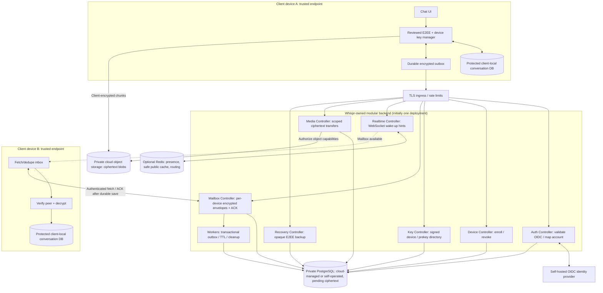

# Whispr — System Architecture

> **Status:** Target architecture for the existing Whispr project. This is an incremental redesign of the current application, **not** a separately branded version or a parallel system. The code does not yet implement this design.

## Decision

Whispr will use **local-first encrypted conversation history**. Each authorized endpoint owns its long-term chat database; the backend operates a **temporary encrypted delivery mailbox** and encrypted attachment service. A server may need to retain ciphertext while a recipient is offline, but it must not be the permanent archive of delivered conversations.

A strict online-only delivery mode can be evaluated later, but cannot replace offline mailboxes without explicitly sacrificing reliable offline delivery.

## Current implementation (as-is)

- `/app`: Next.js client using Supabase Auth, PostgreSQL, and Realtime directly; the current `messages` table retains encrypted chat history. Browser keyring material is serialized into `localStorage`.
- `/demo`: separate Next.js demo surface backed by Express/Socket.IO, independently issued JWTs and repository adapters (memory, filesystem, Postgres). It does not exercise the same persistence/authentication path as `/app`.
- These paths are not yet unified. Current encryption uses static browser P-256 ECDH, HKDF-SHA256 and AES-GCM; secure ratcheting and multi-device fanout are not implemented.
- Existing SQL migrations and application table expectations require reconciliation before deploying a fresh environment.

## Target logical architecture — self-hosted Whispr

The diagram depicts **logical modules**, not independent microservices. Supabase is **not** part of the target runtime. Authentication uses a reviewed, self-hosted OIDC provider (Keycloak is an evaluated option), while Whispr controllers validate sessions and authorize device operations. PostgreSQL and object storage may be **cloud-managed** while their data contracts and access policies remain Whispr-owned. Reuse the current Express/Socket.IO code only after its auth/security issues are fixed.

**No direct browser-to-PostgreSQL access in the target.** The app calls a versioned Whispr HTTP API and authenticated realtime gateway. Redis is non-authoritative; loss of wake-up notifications is repaired by mailbox fetch on reconnect. See [Self-Hosted Backend and Supabase Exit](./15_Self_Hosted_Backend_and_Supabase_Exit.md) for controller ownership and safe cutover.

## Cloud deployment option (TARGET)

The Whispr controller architecture can run on **cloud-hosted containers**, with privately networked **managed PostgreSQL**, private cloud object storage, cloud secrets/monitoring and optional managed Redis. A reviewed OIDC provider can also be deployed in isolated cloud containers. Application control, schema ownership, per-device authorization, ciphertext-only object rules and client E2EE do **not** depend on manually operating every database host or storage server.

Start with one region and a modular monolith; use a stable HTTPS/WebSocket ingress. AWS ECS/Fargate, RDS and S3 form one illustrative profile, not an exclusive stack. Cloud hosting does not change the pending-only server mailbox or safe Supabase exit process. See [Cloud Hosting and Deployment](./16_Cloud_Hosting_and_Deployment.md).

## Preferred deployable topology — Vercel, Render, optional R2 (TARGET)

**Vercel** hosts the existing Next.js `client/` and static assets; end-to-end encryption and persistent history execute in each client device. **Render** hosts Whispr's authenticated Node.js controllers, Socket.IO gateway and background workers, alongside a separately secured reviewed OIDC provider and **paid Render PostgreSQL**. Render Key Value is optional for ephemeral presence and multi-instance routing.

For **text-only messaging**, no cloud media object store is necessary. The **media feature later opts in to private Cloudflare R2**, using server-issued short-lived scoped S3-compatible transfer URLs and direct **client-encrypted** PUT/GET. AWS S3 is an alternative, not a required part of the platform. Render filesystem must not be the authoritative shared attachment store. Realtime wake-up hints do not replace durable pending mailboxes.

This is a **hosting choice, not a change in the crypto or data-trust model**. Deployment and credential configuration are not implemented. Details: [Vercel + Render + Optional R2](./17_Render_Vercel_R2_Deployment.md).

## Responsibilities and trust boundaries

| Component | Must do | Must not do |
| --- | --- | --- |
| Web client | Encrypt/decrypt, maintain encrypted history, durable outbox, verify peer identity, apply message state | Upload plaintext, export plaintext private keys into ordinary local storage |
| Self-hosted OIDC + Whispr Auth/Device Controllers | Authenticate accounts, map trusted OIDC identities to local account UUIDs, register/revoke devices | Roll custom password/OAuth cryptography or equate account login with E2EE identity verification |
| Delivery mailbox | Persist only pending per-device encrypted envelopes, deduplicate, expire, authenticate fetch/ACK | Preserve a permanent server-side conversation transcript |
| Media service | Accept encrypted chunks, enforce quota, return scoped object capabilities, expire blobs | Obtain plaintext files or file encryption keys |
| Realtime gateway | Send wake-up hints and trigger mailbox fetch | Be the sole delivery mechanism or be treated as a durable queue |
| Private PostgreSQL (cloud-managed or self-operated) | Hold Whispr account/OIDC mapping, devices, public bundles, pending envelopes, dedup ledger and outbox | Contain IdP passwords, plaintext history or delivered archives |
| Local DB | Persist messages, attachments, ratchet state and delivery cursors | Assume browser storage is immune to XSS or eviction |

## Text message lifecycle

1. Sender verifies recipient identity/key status, advances a reviewed E2EE session, encrypts the message and **atomically** persists the outbound envelope plus local state.
2. Sender uploads an opaque, versioned envelope with a stable `envelope_id`/idempotency key for each authorized recipient device.
3. Backend authorizes sender and recipient device, durably queues ciphertext with explicit expiry and returns a queue receipt (not a read receipt).
4. Realtime sends an optional wake-up hint; offline devices poll/fetch on reconnect.
5. Receiver validates device/session identity and replay state, decrypts and **durably persists** inbound state/message before acknowledging the envelope.
6. Backend removes the acknowledged envelope for that device; an expiry worker purges unacknowledged envelopes past the configured TTL and informs the sender of expiry when possible.

At-least-once delivery, duplicate detection, reconnect cursors and bounded retention are explicit requirements. Backend acceptance, device delivery and human reading are separate states. No promise of server deletion can erase recipient backups or exports.

## Media lifecycle

Client validates the file, generates independent attachment encryption material, encrypts metadata and content/chunks locally, uploads only ciphertext, and sends the capability plus decryption material inside an E2EE message. The recipient downloads, authenticates each chunk/manifest and saves the decrypted content to protected local storage. Expiry must not occur before the intended recipient devices have a retrieval opportunity; time-bounded cleanup is mandatory. Use strict quota, type, size and safe-rendering rules.

## Optimized physical database boundaries (TARGET)

The backend is **not** a permanent conversations/messages repository in steady state. For reliable asynchronous delivery, keep only small device/profile/key-bundle metadata, a `delivery_keys` ledger for bounded retry idempotency, a `pending_envelopes` ciphertext-only hot table, and a `mailbox_events` transactional notification outbox. ACK/expiry deletes payload while preserving an expiring metadata tombstone; media bytes live in object storage, not PostgreSQL.

The client owns ordered chat history, protocol state, dedup keys and encrypted media references. Recipient-specific keyset mailbox cursors are for paginating pending rows, **not permanent commit-order checkpoints**; refresh scans on reconnect and periodically. Avoid optimizing by prematurely adding Redis as a durable queue or partitioning before measuring churn.

Physical table/index examples, security boundaries, and safe migration rules: [Optimized Database Design](./14_Optimized_Database_Design.md).

## Multi-device and backup policy

- Each device has its own registered device identifier and cryptographic sessions; fanout is per device, not a shared account-wide private key.
- New-device history does **not** automatically appear from server history; use explicit paired-device transfer or user-controlled E2EE encrypted backup.
- Device revocation blocks future delivery/fresh key material but cannot revoke already copied plaintext.
- Backup secrets are **separate from login passwords**. Never silently overwrite a backup after a failed restore.
- On the web, IndexedDB/OPFS are candidates for ciphertext storage, not immunity from malicious scripts; evaluate native clients for stronger executable and OS key isolation.

## Scalability and cache boundaries (target)

The initial architecture remains a **single modular backend**, but module APIs should support later independent horizontal scaling: account/device control plane, durable mailbox delivery, stateless realtime gateways, and encrypted media authorization/data plane. Application instances must not keep unique authoritative mailbox state in their own memory.

- **Durability:** PostgreSQL is authoritative for pending per-device ciphertext and ACK/idempotency state. Transactional outbox workers retry wake-up notifications after backend or Redis failures.
- **Connection scale:** stateless WebSocket gateways may use ephemeral Redis gateway/presence mappings; reconnect always fetches mailbox data by stable cursor. Redis Pub/Sub is a hint, never a durable message queue.
- **Cache hierarchy:** bounded RAM UI cache → encrypted device-local IndexedDB/OPFS history → optional Redis for allowlisted public metadata/presence/rate limits → PostgreSQL pending mailbox → private ciphertext object storage/authorized CDN. The device-local database is **not** a disposable server cache.
- **Independent media:** clients upload encrypted chunks directly to private object storage through narrowly scoped temporary capabilities. API gateways do not proxy large media bytes by default.
- **Admission control:** enforce per-device/account pending-envelope, media-byte, concurrent upload, API request and socket quotas. On overload, respond with retryable errors rather than reporting undurable acceptance.
- **Scale by evidence:** first single-region PostgreSQL with gateway/API replicas; later DB indexing, batch expiry, measured partitioning, regional edges and only eventually home-region mailbox ownership with fenced failover.

Cache invalidation, authorization, short-lived public-key directory entries, TTL candidates, observability and failure testing are specified in [Scalability and Caching](./13_Scalability_and_Caching.md).

## Non-goals for the first iteration

No Kafka, Kubernetes, distributed microservice deployment, custom ratchet implementation, group protocol, voice/video calling, or server-side searchable chat index. First make one-to-one text + encrypted file delivery reliable and auditable.

## Production ownership and migration boundaries

The Whispr deployment operates its own backend modules, PostgreSQL, self-hosted OIDC provider and private object store. The identity provider retains credential/MFA secrets; Whispr keeps only validated identity mappings and device access policies. Protect internal database, cache and object-store networks; use service-scoped credentials, TLS, audited migrations, backups and tested restores.

The current Supabase-based `/app` and separate Express `/demo` remain **legacy implementation surfaces**, not a permitted long-term split. Replace them through additive migrations and client dual-read; verify old ciphertext/key backup recovery before disabling Supabase. Keep the legacy Supabase schema as evidence until retirement. See [Self-Hosted Backend and Supabase Exit](./15_Self_Hosted_Backend_and_Supabase_Exit.md).

## Required implementation proof

Integration tests must cover crash-after-encryption, crash-before-ACK, duplicate envelopes, out-of-order messages, offline TTL, device revocation, forged directory keys, tampered attachments, RLS tenant isolation and safe migration. See [Roadmap](./10_Development_Roadmap.md), [Data Design](./08_Database_Design.md), [API Design](./09_API_Design.md), and [Threat Model](./06_Threat_Model.md).
