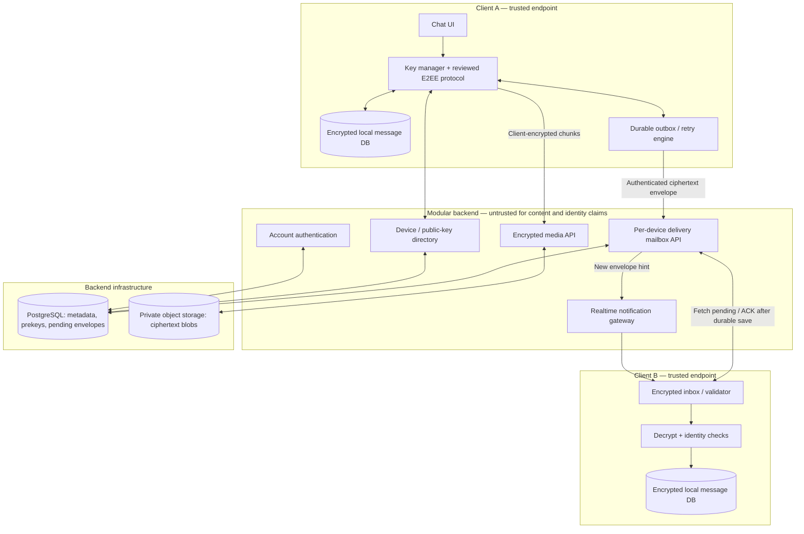

# Whispr — System Architecture

> **Status:** Target architecture for the existing Whispr project. This is an incremental redesign of the current application, **not** a separately branded version or a parallel system. The code does not yet implement this design.

## Decision

Whispr will use **local-first encrypted conversation history**. Each authorized endpoint owns its long-term chat database; the backend operates a **temporary encrypted delivery mailbox** and encrypted attachment service. A server may need to retain ciphertext while a recipient is offline, but it must not be the permanent archive of delivered conversations.

A strict online-only delivery mode can be evaluated later, but cannot replace offline mailboxes without explicitly sacrificing reliable offline delivery.

## Current implementation (as-is)

- `/app`: Next.js client using Supabase Auth, PostgreSQL, and Realtime directly; the current `messages` table retains encrypted chat history. Browser keyring material is serialized into `localStorage`.
- `/demo`: separate Next.js demo surface backed by Express/Socket.IO, independently issued JWTs and repository adapters (memory, filesystem, Postgres). It does not exercise the same persistence/authentication path as `/app`.
- These paths are not yet unified. Current encryption uses static browser P-256 ECDH, HKDF-SHA256 and AES-GCM; secure ratcheting and multi-device fanout are not implemented.
- Existing SQL migrations and application table expectations require reconciliation before deploying a fresh environment.

## Target logical architecture

The diagram depicts **logical components**, not separate deployable microservices. Start with one backend deployment containing modules for identity, mailbox, media and notifications; split only when usage and operational evidence warrants it. Supabase Auth and Postgres can be retained, but browser-direct message-table access must be replaced or tightly constrained by a stable delivery API/RLS contract.

## Responsibilities and trust boundaries

| Component | Must do | Must not do |
| --- | --- | --- |
| Web client | Encrypt/decrypt, maintain encrypted history, durable outbox, verify peer identity, apply message state | Upload plaintext, export plaintext private keys into ordinary local storage |
| Auth + device directory | Authenticate accounts, register devices, publish signed key bundles, enforce device revocation | Assert an unverified key is the real user's identity |
| Delivery mailbox | Persist only pending per-device encrypted envelopes, deduplicate, expire, authenticate fetch/ACK | Preserve a permanent server-side conversation transcript |
| Media service | Accept encrypted chunks, enforce quota, return scoped object capabilities, expire blobs | Obtain plaintext files or file encryption keys |
| Realtime gateway | Send wake-up hints and trigger mailbox fetch | Be the sole delivery mechanism or be treated as a durable queue |
| PostgreSQL | Hold accounts, devices, key-bundle metadata, pending delivery envelopes, limited audit state | Contain plaintext chat history or permanent delivered-message archives |
| Local DB | Persist messages, attachments, ratchet state and delivery cursors | Assume browser storage is immune to XSS or eviction |

## Text message lifecycle

1. Sender verifies recipient identity/key status, advances a reviewed E2EE session, encrypts the message and **atomically** persists the outbound envelope plus local state.
2. Sender uploads an opaque, versioned envelope with a stable `envelope_id`/idempotency key for each authorized recipient device.
3. Backend authorizes sender and recipient device, durably queues ciphertext with explicit expiry and returns a queue receipt (not a read receipt).
4. Realtime sends an optional wake-up hint; offline devices poll/fetch on reconnect.
5. Receiver validates device/session identity and replay state, decrypts and **durably persists** inbound state/message before acknowledging the envelope.
6. Backend removes the acknowledged envelope for that device; an expiry worker purges unacknowledged envelopes past the configured TTL and informs the sender of expiry when possible.

At-least-once delivery, duplicate detection, reconnect cursors and bounded retention are explicit requirements. Backend acceptance, device delivery and human reading are separate states. No promise of server deletion can erase recipient backups or exports.

## Media lifecycle

Client validates the file, generates independent attachment encryption material, encrypts metadata and content/chunks locally, uploads only ciphertext, and sends the capability plus decryption material inside an E2EE message. The recipient downloads, authenticates each chunk/manifest and saves the decrypted content to protected local storage. Expiry must not occur before the intended recipient devices have a retrieval opportunity; time-bounded cleanup is mandatory. Use strict quota, type, size and safe-rendering rules.

## Multi-device and backup policy

- Each device has its own registered device identifier and cryptographic sessions; fanout is per device, not a shared account-wide private key.
- New-device history does **not** automatically appear from server history; use explicit paired-device transfer or user-controlled E2EE encrypted backup.
- Device revocation blocks future delivery/fresh key material but cannot revoke already copied plaintext.
- Backup secrets are **separate from login passwords**. Never silently overwrite a backup after a failed restore.
- On the web, IndexedDB/OPFS are candidates for ciphertext storage, not immunity from malicious scripts; evaluate native clients for stronger executable and OS key isolation.

## Scalability and cache boundaries (target)

The initial architecture remains a **single modular backend**, but module APIs should support later independent horizontal scaling: account/device control plane, durable mailbox delivery, stateless realtime gateways, and encrypted media authorization/data plane. Application instances must not keep unique authoritative mailbox state in their own memory.

- **Durability:** PostgreSQL is authoritative for pending per-device ciphertext and ACK/idempotency state. Transactional outbox workers retry wake-up notifications after backend or Redis failures.
- **Connection scale:** stateless WebSocket gateways may use ephemeral Redis gateway/presence mappings; reconnect always fetches mailbox data by stable cursor. Redis Pub/Sub is a hint, never a durable message queue.
- **Cache hierarchy:** bounded RAM UI cache → encrypted device-local IndexedDB/OPFS history → optional Redis for allowlisted public metadata/presence/rate limits → PostgreSQL pending mailbox → private ciphertext object storage/authorized CDN. The device-local database is **not** a disposable server cache.
- **Independent media:** clients upload encrypted chunks directly to private object storage through narrowly scoped temporary capabilities. API gateways do not proxy large media bytes by default.
- **Admission control:** enforce per-device/account pending-envelope, media-byte, concurrent upload, API request and socket quotas. On overload, respond with retryable errors rather than reporting undurable acceptance.
- **Scale by evidence:** first single-region PostgreSQL with gateway/API replicas; later DB indexing, batch expiry, measured partitioning, regional edges and only eventually home-region mailbox ownership with fenced failover.

Cache invalidation, authorization, short-lived public-key directory entries, TTL candidates, observability and failure testing are specified in [Scalability and Caching](./13_Scalability_and_Caching.md).

## Non-goals for the first iteration

No Kafka, Kubernetes, distributed microservice deployment, custom ratchet implementation, group protocol, voice/video calling, or server-side searchable chat index. First make one-to-one text + encrypted file delivery reliable and auditable.

## Required implementation proof

Integration tests must cover crash-after-encryption, crash-before-ACK, duplicate envelopes, out-of-order messages, offline TTL, device revocation, forged directory keys, tampered attachments, RLS tenant isolation and safe migration. See [Roadmap](./10_Development_Roadmap.md), [Data Design](./08_Database_Design.md), [API Design](./09_API_Design.md), and [Threat Model](./06_Threat_Model.md).
