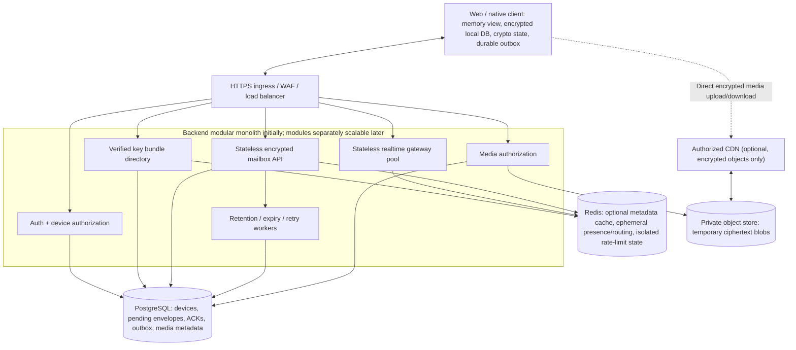

# Whispr — Scalability, Caching, and Data Lifecycle

> **Status: TARGET / NOT IMPLEMENTED.** This is a design extension to the **existing Whispr project**. It does not define a separate version, deployment, or new product. All cache TTLs, service targets, throughput examples and regions in this document are **proposals to validate**, not current operational claims.

## 1. Architectural decisions

1. **Endpoint-owned history:** encrypted, durable conversation records belong on each authorized device. The backend's durable message content is limited to **pending**, per-device E2EE envelopes and necessary temporary operations.
2. **Clear control/data planes:** identity/device directory, message delivery, realtime wake-up, and encrypted media have distinct contracts, even if they start as modules in **one backend deployment**.
3. **PostgreSQL authoritative for pending deliveries:** durable, transactional insertion, idempotency, ACK, and expiry. A Redis cache or Pub/Sub event **never** becomes the only copy of an undelivered message.
4. **Redis is optional and reconstructible:** safe metadata caching, presence, ephemeral gateway routing and separately isolated security rate-limit state. The application must function correctly when Redis loses state.
5. **Independent encrypted media plane:** authorize transfers via the API; use scoped, short-lived storage capabilities for direct upload/download of client-encrypted chunks. Never send a file key or plaintext thumbnail to the CDN/object store.
6. **No premature distributed infrastructure:** no mandatory Kafka, Kubernetes, global active-active database or microservice rollout. Add them only when measured SLOs, team needs or load justify them.

## 2. Target logical component topology



The diagram is a **logical decomposition**, not a recommendation to deploy every box as a service. A native client may eventually offer a stronger executable-trust model than dynamically delivered browser scripts.

## Self-hosted controller and infrastructure ownership (TARGET)

Supabase is a **legacy implementation dependency**, not the future platform. Initial production uses Whispr-owned Node.js/TypeScript modules with an independently deployed **self-hosted reviewed OIDC provider** (Keycloak is an evaluated option), private **cloud-managed or self-operated PostgreSQL**, cloud object storage for ciphertext and optional **managed** Redis. The Auth Controller verifies OIDC issuer/audience/JWKS and maps trusted identities to stable Whispr account UUIDs. Device authorization, revocation and mailbox access are enforced in controller/service policies, never assumed from cached data or direct browser database grants.

Whispr's WebSocket/Socket.IO gateways may scale horizontally, using Redis only for ephemeral presence and wake-up routing; they do not receive the only copy of undelivered ciphertext. The backend is a **modular monolith first**, with independent data/control/media responsibilities and workers; use Docker Compose for development, and backed-up single-region **cloud infrastructure** initially, and defer partitioning and cross-region writers until evidence supports them.

**Self-hosted operations are a security responsibility:** TLS/CA verification, isolated internal networks, least-privilege database and object-store roles, OIDC upgrades and secret rotation, PostgreSQL point-in-time recovery/restore drills, object expiry consistency, observability without message content, and documented incident response. Explicitly test OIDC unavailability, PostgreSQL recovery, object-store failure, and rollback during legacy Supabase exit.

See [Self-Hosted Backend and Supabase Exit](./15_Self_Hosted_Backend_and_Supabase_Exit.md).

## Cloud-hosted deployment and managed services

Run Whispr-owned controllers, Socket.IO gateways, workers and the selected reviewed OIDC provider on cloud compute as container workloads. A private **managed PostgreSQL** service can own durable pending ciphertext/ACK/outbox, an **S3-compatible or provider-native object store** can hold temporary media ciphertext, and **managed Redis** remains optional for ephemeral coordination. Cloud-hosting does not alter E2EE or eliminate application authorization obligations.

Use cloud IAM roles and private networking, short-lived object capabilities, secrets management, p95 queue/reconnect metrics and tested restore drills. Scale API and gateway replicas separately when measured; never use cloud Redis Pub/Sub or WebSockets as the durable mailbox. Note that serverless WebSocket platforms may impose connection timeouts and reconnect costs.

See [Cloud Hosting and Deployment](./16_Cloud_Hosting_and_Deployment.md).

## 3. Delivery correctness and mailbox state machine

**Client-facing logical states:**

- `local_queued`: sender committed ciphertext + session/outbox state on-device.
- `accepted`: server committed pending envelope to authoritative durable mailbox.
- `delivering`: optional leased attempt, never a claim that a recipient persisted data.
- `delivered`: authenticated recipient device ACKed **after** durable local inbox and cryptographic-state commit.
- `read`: distinct, opt-in E2EE user event; not equivalent to network acceptance.
- `expired`: pending item exceeded configured retention, sender is informed when feasible.
- `failed`: explicit permanent failure; retriable transport failures retain the same envelope ID.

Use **at-least-once** transport with exactly-once *logical application effects* via idempotent receiver processing. Never claim that a WebSocket event, Redis publish or HTTP 200 means the recipient has a permanent copy. A malicious server can still omit messages: E2EE does not provide availability.

**Required correctness mechanisms:**

- Bind sender account/device from authentication; authorize each destination device and each ACK.
- Stable random `envelope_id` plus scoped idempotency key; uniqueness/retention policy prevents retries from enqueuing duplicates.
- Atomic server mailbox insert **and** transactional event-outbox record. Workers publish wake-up hints after commit; redrive missed publication.
- Device reconnect always performs authenticated cursor/keyset mailbox fetch, even when no notification arrived.
- Recipient commits message, dedup marker, ratchet/session state and inbox cursor atomically; sends ACK only after successful durable commit. Repeated envelopes/ACKs are harmless.
- ACK transaction atomically updates delivery receipt and purges (or marks purge pending for worker) recipient-specific ciphertext; enforce per-device authorization.
- Workers implement bounded retry/jitter, backpressure and timely expiry; expired undelivered envelopes are not silently represented as delivered.
- For every-device fanout, track ACK and expiry independently. Do not remove ciphertext for still-pending devices when the first device acknowledges.

**WebSocket events are hints:** `mailbox:available` should not include plaintext and need not carry ciphertext. If Redis/pubsub or a gateway loses the event, the pending row remains in PostgreSQL for fetch.

## 4. Cache tiers, ownership, and allowed content

| Tier | Allowed data | Source of truth | Policy |
| --- | --- | --- | --- |
| Client RAM | Decrypted *currently viewed* messages, transient UI state, rendered thumbnails | Client protected store | Bound memory; clear sensitive UI/session state on lock/logout where practical |
| Client IndexedDB | Protected local chat history, outbox/inbox, protocol state, encrypted metadata | **This is durable endpoint data, not a disposable server cache** | Explicit local-at-rest encryption, crash consistency, quota/eviction detection and encrypted recovery |
| Client OPFS | Large **encrypted** media files and encrypted cache objects | Endpoint store / optional authenticated remote ciphertext until expiry | Per-chat retention and capacity limits |
| Redis: profile lookup | Only publicly disclosed, non-sensitive profile display fields | Authorized Postgres view | **Proposed** 5–15 min TTL, invalidate on mutation |
| Redis: key directory | Only signed, authenticated **public** device-key bundles | Authoritative directory + client-pinned identity | **Proposed** 30–120 sec TTL; version + revocation checking, immediate invalidation |
| Redis: presence | Approximate online state, opaque device connection routing | Current live gateway state | **Proposed** 45–90 sec renewed TTL; loss means unknown/offline |
| Redis: notification fanout | Short-lived wake-up events | PostgreSQL mailbox | Best-effort; loss recovers through polling/fetch |
| Redis: rate limits | Temporary counters for abuse and enrollment/login throttles | Operational abuse policy | TTL = rate window; isolate eviction/memory from ordinary cache |
| PostgreSQL | Pending encrypted envelope + ACK, device directory, transactional outbox, metadata | **Authoritative server state** | Message rows delete after valid ACK or expiration, not due to cache eviction |
| Object store / private CDN | Temporary **ciphertext** media bytes | Authoritative object store | Scoped authorization, short-lived capabilities, retention + CDN expiry/purge coordination |
| Static CDN | Content-hashed JS/CSS/icons | Build artifacts | Long-lived immutable assets; no personalized auth responses |

**Never put** plaintext chats, private keys, account passwords, backup passphrases, decryption keys, session tokens, private email directory fields, plaintext previews, or sensitive account-specific HTML/JSON in Redis, CDN, generic HTTP caches or Service Worker Cache API.

A browser DB needs explicit **local-at-rest encryption**: IndexedDB itself is not automatically end-to-end encrypted. Browser eviction and hostile same-origin JavaScript remain threats even with Web Crypto non-extractable keys.

### Suggested Redis namespaces (design only)

```text
profile:public:<opaque-account-id>            TTL 600s
directory:bundle:<opaque-device-id>:<version> TTL 60s
presence:<opaque-device-id>                   TTL 60s
gateway:<opaque-device-id>                    TTL 60s
ratelimit:send:<opaque-account-id>             TTL by enforcement window
ratelimit:login:<opaque-source-id>             TTL by enforcement window
```

Use least-privilege Redis credentials, encrypted connections, restricted network ingress, memory limits and per-role isolation. Cache identifiers should be opaque, bounded and free of emails, tokens or secrets. Separate rate limiting into a dedicated instance or reserved eviction-safe memory policy once shared-cache pressure is possible.

### Cache-aside and invalidation

- Read: authorize request, then use cache for **permitted public fields**; on miss query authoritative store, cache with TTL plus jitter to reduce stampedes.
- Write: commit database mutation, then invalidate matching keys and propagate versioned change events. For key rotation or revocation, authorization decisions must not rely on stale cached success.
- Negative cache: keep short and distinguish permission-denied from not-found; avoid user enumeration and cross-tenant leakage.
- Never bypass authorization because an item was previously cached for another device/account.
- Where strict revocation is required, check authoritative version/epoch or enforce short-lived capability validity rather than trusting a cache entry's TTL.

### Cache failure and failure isolation

| Failure | Expected behavior |
| --- | --- |
| Redis unavailable/empty | Query authoritative Postgres for permitted metadata; mailbox still works; reconnect fetch restores missed events |
| Redis Pub/Sub hint lost | Device mailbox poll/fetch recovers envelope; sender acceptance is unchanged |
| Presence expires | Display unknown/offline, not reliable online presence |
| Cached device bundle stale | Validate revision/revocation and client identity pin; block silent substitution |
| Rate-limit state down | Apply conservative per-instance fallback or fail closed for high-risk endpoints; **never silently disable protections** |
| RAM view cache evicted | Reload local protected DB; don't request a permanent server conversation archive |
| IndexedDB/OPFS loss | Restore only with user-managed encrypted backup/paired-device transfer; make data-loss limitation explicit |
| CDN cache unavailable | Fetch authorized encrypted object from private origin |
| Origin ciphertext deleted | Invalidate/revoke capabilities and purge CDN where available; disclose that retention/deletion is not instantaneous |

### Optimized physical queue decision

Keep the logical per-device mailbox API but implement it with **three narrow physical tables**, not one permanent chat transcript: `delivery_keys` (small idempotency/terminal receipt ledger), `pending_envelopes` (ciphertext only while pending) and `mailbox_events` (transactional wake-up outbox). Delete the ciphertext payload on ACK/expiry while keeping a bounded terminal ledger for safe sender retries. Do not update SQL for every WebSocket send attempt.

The inbox index is `(recipient_device_id, created_at, envelope_id)`, with a separate expiry scan and ready-event worker index. The timestamp keyset cursor is only for **a single pending-mailbox sweep**: it does not represent commit order; redo an inbox scan on reconnect and periodically, with client deduplication. Keep the **dedup window longer than the permitted sender retry horizon** and ensure account/device authorization for conflicts and terminal statuses.

A representative table/constraint design, enqueue/ACK races and client-local transaction strategy are in [Optimized Database Design](./14_Optimized_Database_Design.md).

## 5. PostgreSQL physical scalability

**Logical mailbox row fields** (proposed; exact SQL requires an approved migration):
```text
envelope_id (opaque random id)
recipient_device_id / sender_device_id
protocol_version / ciphertext / created_at / expires_at
delivery_state / retry_after / lease_version (if leases are needed)
server_receipt_time
```

- Mailbox read: index by `recipient_device_id` and stable cursor (e.g. `created_at, envelope_id`). Use keyset pagination and bounded per-page size rather than large SQL `OFFSET`.
- Dedup: key uniqueness within recipient device and bounded retention; validate idempotency key shape and stale retry handling.
- ACK/status: apply compare-and-set or single transaction so retries cannot delete another device's envelope.
- Expiry: begin with scheduled, **bounded batch deletes** and indexes on `expires_at`; do not add partition complexity without evidence.
- Partition later by bounded time ranges or recipient-device hash after evaluating queue residence time and query behavior. Account for PostgreSQL's partitioned unique-constraint restrictions and envelopes that remain pending near expiry.
- Use read replicas for safe metadata reads where lag is acceptable; **do not** route ACK/revocation or critical queue state through an eventually consistent replica.
- Cap connection pools; measure index bloat, vacuum, queue age, DB contention and retention-worker progress.

## 6. WebSocket horizontal scaling and backpressure

Maintain a pool of independently replaceable gateway instances behind an ingress supporting long-lived connections. Connections authenticate a specific device; Redis may map device to current gateway with heartbeat TTL. Never require sticky sessions to restore durable messaging correctness.

Gateways send only lightweight wake-up hints. Clients reconnect with exponential backoff + jitter, reauthenticate, refresh key/device revocation status and fetch pending mailbox rows. Deployments support connection draining; reconnect storms must have per-device jitter and admission limits. Prioritize control traffic over large payloads.

Protect backend resources with limits on outstanding envelopes, bytes per sender/device, number of devices, simultaneous media uploads, unread queue age, request size, database connections and worker concurrency. On overload, respond with explicit retryable `429/503` and `Retry-After` rather than falsely acknowledging durability.

## Vercel + Render operational scale profile (TARGET)

Use **Vercel** for the Next.js frontend, **Render** for the Whispr API and Socket.IO gateway (one always-on web service initially), and **paid Render PostgreSQL** for pending ciphertext and delivery receipts. Socket.IO must recover from Render restarts/redeploys using mailbox fetch; avoid assuming a single always-on connection. **Render Key Value (Redis-compatible / Valkey)** is optional and never contains the authoritative mailbox or encryption secrets.

**No object store for a text-only MVP.** Introduce **Cloudflare R2** only for encrypted attachment bytes, in a *private* bucket with short-lived signed R2 S3 API URLs. Enforce application authorization on every capability request and exact CORS/headers for Vercel browser origins. Do not expose a public R2 bucket or use Render persistent disks as horizontally scalable shared media storage. Evaluate R2 Standard storage, requests and lifecycle costs separately from Render/Postgres baseline.

Provider guide and failure matrix: [Vercel + Render + Optional R2](./17_Render_Vercel_R2_Deployment.md).

## 7. Independent media delivery and CDN

Media API issues scoped upload and download capabilities after authorization, per-account quotas and object/size constraints. Client encrypts **before upload** and uses authenticated chunking with unique nonce discipline. Chunk integrity, ordering and final manifest verification are performed client-side. Transfer retry must not reuse nonce/key pairs unsafely.

An upload session is separate from a chat envelope; unreferenced uploads and expired/downloaded objects require background cleanup. Multiple devices can reference one encrypted blob only if each receives legitimate decryption authorization in an E2EE manifest.

**CDN policy:** cache immutable static resources freely; use CDN for E2EE ciphertext only with validated access controls and carefully designed cache keys. A signed URL is a bearer capability while valid. Do not cache private auth/API JSON at shared edges; never cache decrypted previews. Deleting an origin object may not immediately purge distributed caches.

## 8. Capacity model and service targets

Before selecting sharding, Kafka, or a multi-region writer, estimate:
```text
envelopes_per_day =
    daily_active_users * messages_per_active_user_per_day * recipient_devices_per_message

peak_enqueue_per_second =
    envelopes_per_day * peak_hour_fraction / 3600

approx_pending_bytes =
    average_ciphertext_envelope_bytes * enqueue_rate_per_second * mean_pending_seconds

media_transfer_bandwidth =
    simultaneous_transfers * average_transfer_throughput
```

Use actual measures for fanout, retry amplification, percentages of offline devices, TTL distribution, envelope byte size, number of concurrent sockets and network churn. Design for peak factors and abuse spikes, not just mean traffic.

**Initial SLO candidates — not measured or promised:**

| Measurement | Suggested initial objective |
| --- | --- |
| Authenticated mailbox acceptance | p95 < 250 ms for representative region/load |
| Online recipient end-to-end delivery to device | p95 < 2 s, excluding offline periods |
| Mailbox API availability | 99.9% monthly, subject to accepted service definition |
| Undelivered expiry cleanup | Bounded backlog; alert well before retention SLA is violated |
| Logical duplicate visible to user | Zero in tested replay/reconnect scenarios |
| Missing ACK event recovery | Pending envelope remains retrievable until valid ACK/TTL |
| Media transfer | Measure per-file-size/network class rather than claiming fixed completion latency |

Metrics: acceptance/fetch/ACK latency histograms, duplicate suppressions, queue depth/oldest age, retries, rejection rate, gateway open sockets, Redis misses/evictions, database pool saturation, media bytes/transfer failures and worker lag. Avoid plaintext, private keys, raw contact graphs, and identifying payload logs; use sampled redacted traces.

## 9. Region and sharding strategy

1. **Now:** single region with appropriately available PostgreSQL, horizontally scalable APIs and gateways, private media storage. Add Redis only when distributed coordination or measured caching benefit requires it.
2. **Later:** regional edge routing and media CDN; preserve one authoritative mailbox writer for each device.
3. **At scale:** assign a device/account **home region** and require fenced failover. Do not run globally active-active mailbox writers without consensus/conflict semantics for ACK, deletion, idempotency and revocation.
4. **Very large groups:** evaluate MLS separately and choose a group fanout strategy only after one-to-one per-device delivery is correct.

## 10. Required chaos/security test matrix

| Scenario | Required outcome |
| --- | --- |
| PostgreSQL insert commits but Redis publish fails | Transactional notification outbox recovers; mailbox row remains fetchable |
| Receiver crashes before durable local commit | No ACK; encrypted envelope redelivered on reconnect |
| Receiver crashes after commit but before ACK | Redelivery is deduped and valid ACK is safe |
| Same envelope sent/retried many times | One pending logical item per recipient device |
| Redis wiped during gateway activity | Presence resets; no durable envelope lost |
| Revoked device has old cached key/session | Future mailbox fetch rejected based on authoritative authorization |
| Metadata cache contains private profile field | Security test fails; only allowlisted public fields cacheable |
| Rate-limit Redis evicted/unavailable | Conservative fallback or fail closed as designed |
| CDN authorization/caching mismatch | Access denied; no cross-user encrypted object leak |
| Origin media expired while cached | Deletion/revocation policy behaves as documented, including residual cache windows |
| Queue partition rollover | Pending messages remain deliverable until actual expiry |
| Gateway rolling deploy/reconnect storm | Bounded retries, cursor fetch restores all pending items |

## 11. Implementation checkpoints

Design **now:** state transitions, idempotency, mailbox indexes, cache allowlist, authorization, TTL policy, metrics schema, media capability rules, backpressure and fallback. Implement Redis **when needed** for gateway routing/rate limiting. Add partitioning, regional writes and sharding only after production-like load tests demonstrate the need.

Cross-references: [Architecture](./04_System_Architecture.md), [Database](./08_Database_Design.md), [API](./09_API_Design.md), [Threat Model](./06_Threat_Model.md), [Roadmap](./10_Development_Roadmap.md).

## References

- [Redis Pub/Sub delivery semantics](https://redis.io/docs/latest/develop/pubsub/) — Pub/Sub notifications are not durable message storage.
- [Redis cache-aside pattern](https://redis.io/docs/latest/develop/use/patterns/).
- [PostgreSQL declarative partitioning](https://www.postgresql.org/docs/current/ddl-partitioning.html).
- [MDN Storage quotas and eviction](https://developer.mozilla.org/en-US/docs/Web/API/Storage_API/Storage_quotas_and_eviction_criteria).
