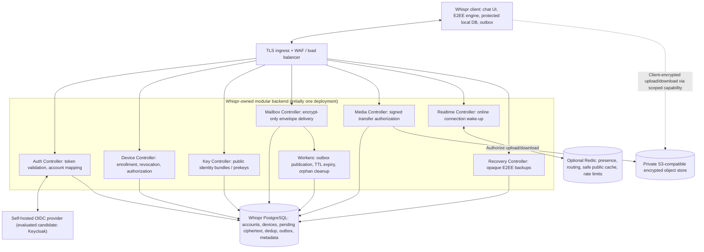

# Whispr — Self-Hosted Backend and Supabase Exit

> **Decision: APPROVED DESIGN DIRECTION; NOT IMPLEMENTED.** Whispr remains **one existing application**, developed incrementally in the current repository. Remove Supabase **as a runtime dependency in the target architecture**. Do not delete its data, schema, credentials, backups, or old code until migration, recovery and rollback gates pass. "Local controllers" means **Whispr-owned backend controllers running on infrastructure we operate**, not a browser-only or peer-to-peer-only system.

## 1. Architecture decision record

| Question | Decision |
| --- | --- |
| Retain Supabase platform for target runtime? | **No.** Replace Auth, PostgREST/browser-direct tables, Realtime and Storage integrations. |
| Authentication | Prefer a **self-hosted standards-based OIDC identity provider**; evaluate Keycloak or an equally reviewed alternative. Whispr Auth Controller validates tokens and maps trusted OIDC identities to local accounts. **Do not write custom password/OAuth/session cryptography.** |
| Backend | Node.js/TypeScript modular monolith initially, extracting and hardening useful Express/Socket.IO code; modular controllers, services, repositories, policies and background workers |
| Database | **Self-managed PostgreSQL** for minimal identity/device metadata, key-bundle data, short-lived per-device ciphertext mailbox, ACK/dedup ledger, event outbox, optional encrypted-backup metadata and media metadata |
| Realtime | Whispr-controlled WebSocket/Socket.IO gateways; events are wake-up hints, not the durable mailbox |
| Cache | Optional Redis for reconstructible presence/gateway routing, allowlisted public metadata and separately protected rate limits; never authoritative for pending messages |
| Media | Private **S3-compatible object store** (self-hosted option such as MinIO), ciphertext-only and scoped temporary transfer credentials; optional authorized CDN later |
| History | Encrypted client-owned indexed storage (browser IndexedDB/OPFS candidates; evaluated encrypted SQLite for native clients), **not permanent server-side history** |
| Deployment | Docker Compose in isolated development; automated backed-up single-region deployment first; high availability and Kubernetes only if requirements demand |
| Versioning | **No new “2.0” branch/product/doc tree.** Contracts may be versioned (e.g. `/v1` HTTP) independently of product branding. |

**Why:** Owning the runtime lets Whispr control authorization, retention, backup/recovery, observability and scaling boundaries. It does **not** make security automatic: operations, IdP patching, disaster recovery and credential recovery become Whispr's responsibility.

## 2. Logical system diagram



This is a **logical** component diagram. Controllers are process modules, not independent microservices by default. A durable remote relay remains essential for offline encrypted delivery. **No private chat key or plaintext is ever sent to backend services for decryption.**

## 3. Controller contracts and trust boundaries

| Module | Responsibilities | Security boundary |
| --- | --- | --- |
| Auth Controller | Validate OIDC issuer/audience/signature/expiry using trusted discovery/JWKS; map `(issuer, subject)` to local account UUID; handle logout/session changes | Never trust arbitrary client-provided account ID or reimplement an insecure JWT-secret default |
| Device Controller | Verified device enrollment (step-up auth or paired-device approval), list/revoke authorized devices; authorize device-scoped operations | Account login alone does not prove possession of an existing messaging private key |
| Key Controller | Distribute signed identity/device bundles; atomic one-time prekey consumption; versioning | Server directory may lie—client pinning, safety numbers and change warnings remain required |
| Mailbox Controller | Validate sender/recipient; idempotent envelope acceptance; fetch pending ciphertext; ACK-after-durable-local-save; expiry | No server permanent history or plaintext; recipient-device authorization required |
| Realtime Controller | Authenticate device connections, send `mailbox:available` hints, handle reconnect and graceful draining | No durable queue in Socket.IO/Redis Pub/Sub; loss of notification must be recoverable |
| Media Controller | Authorized short-lived scoped upload/download capability; quotas, object lifecycle metadata | Never see file keys/plaintext; prevent cross-account URL or cache-key access |
| Recovery Controller | Store/fetch versioned opaque encrypted backups using *separate* recovery secret; safe rotation | Never infer backup passphrase from authentication password; failed restore cannot overwrite prior backup |
| Workers | Transactional notification outbox retry, mailbox TTL/ACK cleanup, media orphan deletion | Bounded batches, idempotency and audit without plaintext or raw contact graph |

**Layering:** `controller → application service + policy → repository interfaces → PostgreSQL/Redis/object store adapters`. Keep authentication/authorization checks central and tested; no public browser direct table grants for internal queue tables. If using a privileged DB connection, RLS alone is insufficient; the API must enforce account/device ownership.

## 4. Authentication architecture

Use an established **self-hosted OIDC** server. Keycloak is an **evaluated candidate**, not a committed library/runtime dependency or a claim that it is already running.

### Stable Whispr account IDs

Do **not** reuse the identity provider's raw `sub` as the primary key for all Whispr rows. Maintain `accounts(account_id uuid PK, ...minimal state...)` and `account_identities(account_id, issuer, subject)` with a unique `(issuer, subject)` constraint. User identity across providers must be verified/explicitly linked, never merged solely by email display value. Public `devices.account_id` FKs point to Whispr accounts.

Keep login credential records within the IdP. The Whispr app DB should not copy password hashes, reset tokens, OTP secrets or OAuth credentials. Access tokens are short-lived and validated; refresh tokens are handled per platform security policy. Validate issuer, audience, signature and token lifetime; cache public JWKS with safe refresh, not a permanent trust decision. Protect device enrollment with step-up proof, explicit pairing where appropriate, and revocation. Use HTTPS, CSRF protection where cookie-backed, strict CORS, session invalidation and rate limits.

**Device identity != login identity.** A signed-in account is necessary for API access, not sufficient to claim a new device's cryptographic identity is verified by peers.

### Existing demo backend

The existing Express `/demo` self-issued JWT flow contains a predictable signing-key fallback and cannot simply become production authentication. Remove that default, isolate demonstration tools and migrate only reviewed routing/validation components. The unauthenticated privileged Next.js `/api/admin` demo route must be removed or isolated behind authorization before public use.

## 5. Optimized PostgreSQL and local store

**Target minimal server tables:** `accounts`, `account_identities`, `public_profiles`, `devices`, protocol-specific signed/one-time public prekeys, `delivery_keys` (bounded idempotency/status tombstones), `pending_envelopes` (ciphertext only while pending), `mailbox_events` (transactional outbox), `media_objects` (ciphertext object metadata) and optional `encrypted_backups`.

**Client-owned:** `conversations`, `messages`, `crypto_sessions`, `outbox`, `inbox_dedupe`, `identity_pins`, `attachments` and mailbox scan state in encrypted local storage.

**Acceptance transaction:** authenticate actual sender device; authorize recipient device; create ledger + pending ciphertext + event-outbox row in a transaction; commit before `accepted`. Recipient ACK changes ledger to delivered and deletes ciphertext while keeping small terminal metadata during sender retry horizon. Realtime publish is optional. Redis is never the source of truth.

**Sync detail:** `created_at` keyset cursor is for **one paginated sweep**, not a permanent commit-order cursor. Concurrent older timestamp writes may commit later; rescan pending mailboxes on reconnect and periodically, deduplicating locally. Media bytes live in private object storage.

See [Optimized Database Design](./14_Optimized_Database_Design.md) for specific indices, schema examples, RLS/ownership pitfalls and migrations. **Its illustrative SQL now uses Whispr-owned accounts and OIDC identity mappings. It remains unexecuted design SQL and requires a reviewed, tested migration before deployment.**

## 6. Source-code direction and migration surface

```text
client/
  src/
    modules/
      auth/                 # OIDC client + protected session handling
      device-identity/      # pairing, trust verification, key manager
      messaging/            # E2EE engine, local history, durable outbox
      media/                # client encryption, uploads, previews
      sync/                 # mailbox reconnect + ACK semantics
    infrastructure/
      local-db/             # protected IndexedDB / OPFS adapters
      api/                  # typed Whispr HTTP and WebSocket client

server/
  src/
    modules/
      auth/                 # controller, identity mapping and policy
      devices/
      keys/
      mailbox/
      media/
      realtime/
      recovery/
    workers/
      publish-outbox/
      expire-mailbox/
      media-cleanup/
    infrastructure/
      postgres/
      redis/
      object-store/
      oidc/
    middleware/
  migrations/              # additive, version-controlled DB migrations
  tests/
infrastructure/
  compose/                 # isolated development services
  deployment/              # infra-as-code, backups, restore drills
```

This is a **target logical layout**, not an instruction to remove existing files immediately. It can be reached incrementally without a sweeping frontend rewrite.

### Existing Supabase integration to retire

| Current source / responsibility | Target path |
| --- | --- |
| `client/src/lib/supabase.js` and `supabase-chat.js` | OIDC auth adapter + Whispr-owned authenticated API client and E2EE local store |
| Browser direct `profiles`, `user_keys`, `messages`, `private_key_backups` access | Backend controllers with explicit policy and device binding |
| Supabase Realtime subscription | Whispr Socket.IO gateway + durable mailbox catch-up |
| Supabase Auth + Google OAuth | Migrated/linkable identities at self-hosted OIDC provider; user-verification-first mapping |
| Supabase Storage (or future managed attachments) | Private S3-compatible store, client-side encryption, scoped transfer authorization |
| `server/supabase/migrations/` | **Keep as legacy migration evidence** until verified data cutover; new self-hosted migrations belong in `server/migrations/` |
| Separate Express `/demo` routes | Isolated educational harness or reviewed modules reused behind new production auth |
| Next.js `/api/admin` demo operations | Remove from product or require explicit privileged authorization in isolated demo |

## 7. Non-destructive Supabase exit plan

**Gate 0 — freeze and inventory:** obtain authorized live Supabase schema/RLS, backup and restore test, count user/auth/key/message/backup objects, map current `/app` vs `/demo` data, record retention requirements. The tracked six migrations do not fully reproduce current `/app` query expectations; repair this understanding *before* extraction. Preserve the original environment for rollback.

**Gate 1 — provision self-hosted services:** isolated PostgreSQL, candidate OIDC provider, private object storage, minimum Whispr API and integration tests. Configure secrets vault, HTTPS, backups, retention, monitoring and least-privilege service credentials. Demonstrate restore from backup.

**Gate 2 — identity migration/linking:** map trusted Supabase Auth identities to Whispr `accounts` through controlled, verified account linking; if password hashes or OAuth credentials cannot be safely migrated, require credential reset or fresh OIDC login. Do not silently merge by email. Revoke/rotate sessions with verified new sign-in and support flows; old JWTs aren't universally interchangeable with the new provider.

**Gate 3 — key and backup safety:** ensure users can decrypt/restore current keyrings *before* switching identity providers. Legacy backups are encrypted using a secret derived from the sign-in password; changing login credentials can make them inaccessible. Introduce independent recovery secrets, explicit re-encryption, restore test and versioned protection before old auth is retired. **Never store or transmit the recovery secret.**

**Gate 4 — add new schema, queues and media:** create device/account mapping, signed prekey directory and ciphertext mailbox in self-hosted PostgreSQL. Implement idempotent ledger/outbox, ACK, expiry, authorization and crypto-negative tests; encrypt media on client into private object storage. No legacy data is dropped.

**Gate 5 — client dual-read / controlled cutover:** existing client reads historical Supabase ciphertext with its historical keyring, decrypts and verifies **on device**, writes encrypted local history; new writes switch to Whispr mailbox API only after verified per-device enrollment. Run staged feature-flag rollout and record migration status without plaintext.

**Gate 6 — retire only after verification:** validate account matching, per-device delivery, message counts and decryptability, new-device recovery, backups, media transfer, retention and incident rollback. Preserve old read-only environment for a defined period, then revoke legacy Supabase credentials/integration and decommission based on authorized data deletion policy. **Never delete old rows merely because new infrastructure started successfully.**

**Rollback principle:** keep a bounded period of read-only legacy access and client migration checkpoints; do not allow divergent dual-writes of sensitive messages without an explicit reconciliation protocol.

## 8. Operations and scalability responsibilities

### Development

Use Docker Compose or equivalent local orchestration for API, self-hosted PostgreSQL, OIDC provider, private S3-compatible store and optionally Redis. Seed *test* identities and media. Avoid checking real secrets into Docker files or example envs.

### Initial production

Single-region modular backend behind HTTPS ingress with restricted internal networks, managed secrets, transactional PostgreSQL backups + point-in-time recovery where feasible, object-store lifecycle policy, encrypted-backup recovery process, health checks, telemetry minimization, and alerting on queue age / delivery failures. Avoid publicly exposing PostgreSQL, Redis or internal S3 credentials.

### Scale after measurement

Stateless API/Socket.IO replicas; Redis only when cross-gateway coordination is necessary; bounded worker concurrency and backpressure; Postgres optimized composite index + vacuum first; partitions and sharding only after actual load; optional regional media CDN with scoped access. Multi-region requires a single authoritative mailbox owner/fenced failover and careful revocation.

**Security limitation:** a compromised web-origin deployment can serve hostile JavaScript. Self-hosting does not eliminate this risk; trust the E2EE endpoint and distribution threat model, not the word “self-hosted”.

## 9. Implementation and verification gates

| Gate | Must demonstrate |
| --- | --- |
| Auth | OIDC issuer/audience/JWKS verification, session expiry/revocation, safe account linking; negative tests for forged tokens |
| Device | Device enrollment approval, revoked device denied, identity key substitution surfaced |
| Mailbox | Pending ciphertext only, correct per-device authorization, transactional enqueue/outbox, idempotent ACK/expiry, lost Pub/Sub recovery |
| Local DB | E2EE state crash atomicity, protected local history, storage-eviction and recovery UX |
| Media | Ciphertext-only uploads, short-lived capabilities, safe previews, quota and orphan cleanup |
| Migration | Verified account mappings, old ciphertext decryptable locally, backup recoverable after auth migration, rollback tested |
| Operations | Backup/restore drills, incident response, TLS/secret rotation, schema migration CI, load and failure-injection results |

## 10. Existing documents affected

[Project Overview](./01_Project_Overview.md) · [Architecture](./04_System_Architecture.md) · [Tech Stack](./07_Tech_Stack.md) · [Database](./08_Database_Design.md) · [Optimized DB](./14_Optimized_Database_Design.md) · [API](./09_API_Design.md) · [Supabase Legacy Setup and Exit](./10_Supabase_Setup.md) · [Scalability](./13_Scalability_and_Caching.md) · [Threat Model](./06_Threat_Model.md) · [Roadmap](./10_Development_Roadmap.md).
