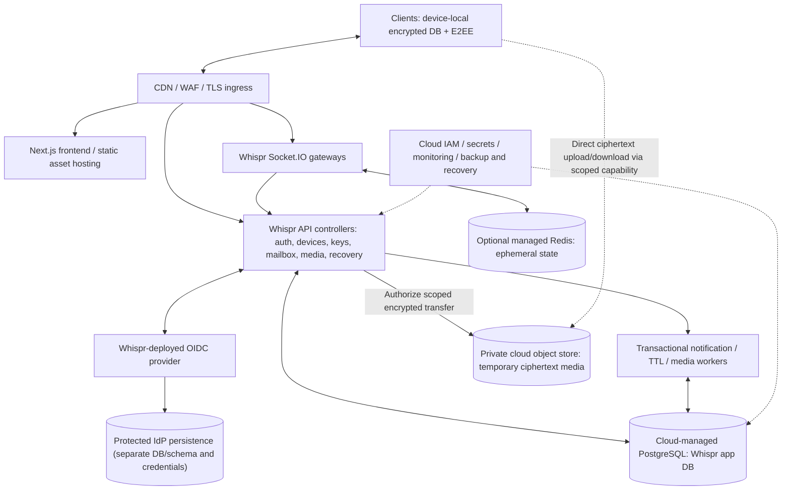

# Whispr — Cloud Hosting and Deployment Architecture

> **Status: TARGET / NOT DEPLOYED.** Whispr remains one existing application and repository, without Supabase as a *target runtime dependency*. **Cloud hosting is compatible with Whispr-owned controllers and local-first E2EE.** “Self-hosted Whispr” refers to ownership/control of application services and identity policy, **not a requirement to physically operate database hosts, storage disks or networking hardware.** This document is a reference design, not evidence of a running cloud deployment or an AWS purchase.

## 1. Cloud hosting decision

**Preferred principle:** Whispr owns and deploys the Node.js/TypeScript backend and Socket.IO controllers, operates a reviewed OIDC identity provider (Keycloak is a candidate), controls the cryptographic protocol and schema, and may use **cloud-managed infrastructure** for PostgreSQL, private object storage, load balancing, secrets and monitoring.

This preserves the original decision to retire Supabase **without** adding avoidable operational responsibility for maintaining OS packages, physical disks or manual database failover. Managed services still require customer-controlled configuration, least-privilege policies, backup/restore verification, cost monitoring, retention and incident response.

- **Client:** local protected IndexedDB/OPFS (or native encrypted SQLite) for encrypted history/ratchet/outbox; the cloud never becomes the permanent chat archive.
- **Application:** Docker images for Whispr API, WebSocket gateway, workers and optionally Next.js SSR, deployed in cloud containers. A modular monolith remains the starting design.
- **Identity:** reviewed OIDC service that Whispr deploys in the cloud (e.g. Keycloak) with a dedicated protected data store; the IdP owns passwords/MFA.
- **PostgreSQL:** dedicated **cloud-managed PostgreSQL is preferred** for the initial public deployment (self-operated Postgres is acceptable where explicitly justified). The schema and access policies remain Whispr-owned.
- **Media:** a **private cloud object-storage service** (e.g. Amazon S3), or compatible privately operated storage; client-side ciphertext only with short-lived scoped upload/download capabilities.
- **Realtime:** WebSocket/Socket.IO gateway running behind HTTPS-capable load balancing. Notifications are wake-up hints; PostgreSQL is the authoritative pending mailbox.
- **Cache:** optional managed Redis for ephemeral presence, gateway mapping, safe public metadata and isolated abuse limits. Never the only store for a pending ciphertext envelope.
- **Runtime resilience:** deployment automation, health checks, rolling/draining restarts, backup/restore drills, limited blast radius, cost budgets and performance SLO instrumentation.

## 2. Logical cloud reference architecture

**No plaintext or E2EE private keys leave the client.** Whispr application authorization applies regardless of whether the database and storage are cloud-managed. A direct browser connection to PostgreSQL is **not** part of the target architecture. A compromised frontend delivery origin remains an E2EE endpoint threat even in the cloud.

## 3. AWS reference implementation (example, NOT mandatory)

| Logical role | AWS reference service | Notes |
| --- | --- | --- |
| HTTPS ingress, protection and static assets | CloudFront, AWS WAF, AWS Certificate Manager, Application Load Balancer | Rate-limit/abuse policy; minimize auth/session payload caching |
| Next.js + Whispr API + workers | Amazon ECS with Fargate (containers) | Start with modest always-on services; keep workers independently restartable |
| Socket.IO gateways | ECS/Fargate behind an ALB supporting WebSockets | Autoscale where measurable; reconnect plus DB mailbox sweep on any disconnect |
| Whispr-operated IdP | Keycloak deployed as isolated cloud containers | Keep credential persistence separate; secure issuer/JWKS, upgrades and backups |
| App database | Amazon RDS for PostgreSQL | Private subnet, least privilege, automated backups and restore drills; add Multi-AZ when availability requires |
| IdP persistence | Separate protected PostgreSQL database/logical role | Avoid making IdP tables share Whispr app credentials |
| Temporary encrypted media | Private Amazon S3 bucket | Short-lived signed object capabilities, quotas, lifecycle cleanup; no plaintext |
| Cache / realtime coordination | Amazon ElastiCache for Redis (optional) | Reconstructible ephemeral state; rate-limit failure policy |
| Secrets / keys / service identities | AWS Secrets Manager, IAM roles, KMS where required | Never embed service credentials in client code or image layers |
| Metrics, traces and audit | Amazon CloudWatch / OpenTelemetry exporters | No plaintext, private message keys or raw contact-graph data |
| Image builds and deployment | Container registry + CI/CD + IaC | Versioned images, gradual deploy, rollback and migration tests |

Amazon ECS/Fargate supports container workloads without the application team provisioning virtual machines. Amazon RDS provides managed Postgres backups and availability features. S3 presigned URLs can grant short-lived upload/download capabilities. Validate exact provider quotas, networking, supported regions and pricing against the selected account and date.

Official references:
- [AWS ECS/Fargate guide](https://docs.aws.amazon.com/AmazonECS/latest/developerguide/AWS_Fargate.html)
- [Amazon RDS backups](https://aws.amazon.com/documentation-overview/relational-database-service/)
- [S3 presigned URLs](https://docs.aws.amazon.com/AmazonS3/latest/userguide/using-presigned-url.html)

## 4. Cloud-neutral deployment portability

Prefer containerized controllers; SQL migrations and PostgreSQL-compatible repository interfaces; S3-compatible object-store adapter; OIDC protocol integration rather than an IdP-specific user table; standard metrics; and versioned config/IaC.

Examples of alternatives: GCP Cloud Run or GKE for compute, Cloud SQL for PostgreSQL, Cloud Storage for objects, Memorystore for Redis; Azure Container Apps/AKS, Azure Database for PostgreSQL and Blob Storage. **Each provider needs compatibility testing**; S3-compatible APIs are not identical to every cloud object-storage API, so implement the transfer-capability adapter rather than assuming interchangeable SDK calls.

**Cloud Run caveat:** WebSockets are supported but subject to request timeouts (up to 60 minutes at the time of the documented guidance) and clients must reconnect; persistent Socket.IO sessions may be operationally different from always-on ECS tasks. Evaluate billing and connection behavior before choosing a scale-to-zero platform for large numbers of long-lived sockets. Reference: [Google Cloud Run WebSockets](https://docs.cloud.google.com/run/docs/triggering/websockets).

## 5. Security and privacy guardrails

- Keep database, Redis, IdP persistence and internal object-store control interfaces on private networks; expose only needed HTTPS endpoints, auth discovery and scoped encrypted media capabilities.
- Use cloud IAM workload identities, least-privilege roles, safe secret rotation, restrictive CORS, authenticated API gateways and proper token verification. Do not trust a cached identity or allow cloud IAM to replace Whispr's device authorization.
- Object storage sees ciphertext **only**. Avoid uploading plaintext MIME/filenames/thumbnails; prevent cross-account replay of signed URLs and CDN cache-key confusion; test deletion/expiry propagation.
- Use approved encryption at rest for cloud-managed disks/backups in addition to **client E2EE**, which remains the confidentiality boundary.
- Backup and recovery policies cover the IdP, Whispr app DB, encrypted media retention, configuration and identity mapping. Test recovery without decrypting private chats or overwriting client key backup state.
- Enforce residency, audit retention and account deletion requirements based on actual deployment/legal obligations. Do not assume region selection alone proves regulatory compliance.
- Separate environments/accounts where practical (development, staging, production) and protect CI/CD signing credentials; infrastructure compromise may affect service availability and identity-directory integrity.

## 6. Reliability, scale and cost phases

| Phase | Practical architecture | Why |
| --- | --- | --- |
| Local development | Docker Compose: Whispr app, reviewed OIDC provider, PostgreSQL, private S3-compatible emulator, optional Redis | Reproducible tests; never production data |
| Small cloud beta | Cloud-hosted app containers + protected PostgreSQL and private object store; IdP separately deployed | Real client access with controlled costs; optimize based on load |
| Initial production | Private managed PostgreSQL, autoscaled API/gateway containers, secure IdP, encrypted media, monitored workers, tested backup/restore | Reliability without premature orchestration complexity |
| Growing load | Gateway replicas and Redis coordination; app DB query/expiry tuning; bounded queues and worker scale | Scale hotspots independently |
| Large or regional | HA DB and IdP, regional edge/media, device home-region routing and fenced failover | Only after availability and geographic measurements demand it |

A single small VM running Docker Compose in the cloud may be useful for a **throwaway demo or controlled beta**, but it is a single failure domain and requires manual patching/backup work; do not treat that topology as automatically production-safe.

### Watch cost drivers

Long-running WebSocket/container capacity, database baseline and backup storage, load-balancer/NAT networking, object-store ingress/egress/requests, observability volume, WAF rules and identity-provider availability. Configure budget alerts and log-retention caps. Do not publish invented cloud price estimates without account-region-specific confirmation.

## 7. Cutover and migration responsibilities

A cloud provider does **not** migrate Supabase account identities or private key backups automatically. The existing [Supabase exit plan](./15_Self_Hosted_Backend_and_Supabase_Exit.md) remains mandatory: legacy schema inventory, proof-based linking of old and new identities, recovery/rekey of password-derived old key backups **before** login change, client-side history migration and tested rollback. Do not delete Supabase or old encrypted data as part of cloud provisioning.

Cloud infra implementation is separately gated: infrastructure-as-code review, network/IAM checks, backup restore drill, load testing, integration tests for device-scoped queue auth, ciphertext-only media upload and WebSocket reconnect/notification-loss recovery.

## 8. Action items and design scope

**Design now:** cloud-neutral service contracts, environment/config ownership, deployment profiles, TLS/WAF networking, IAM boundaries, encrypted media capabilities, backup/restore and cost monitoring.

**Choose later with evidence:** specific cloud vendor, exact container instance sizes, RDS sizing/HA tier, Redis provision, CDN cache policies, multi-region and Kubernetes. Provider examples above **do not** mean those products have been purchased, configured or deployed.

Related documents: [System Architecture](./04_System_Architecture.md), [Tech Stack](./07_Tech_Stack.md), [Optimized Database](./14_Optimized_Database_Design.md), [Scalability](./13_Scalability_and_Caching.md), [Roadmap](./10_Development_Roadmap.md), [Self-Hosted Backend and Supabase Exit](./15_Self_Hosted_Backend_and_Supabase_Exit.md).
