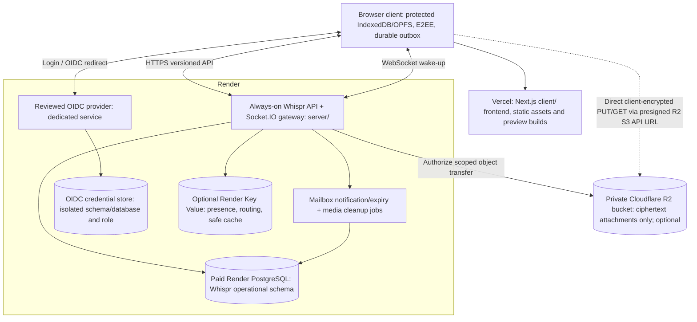

# Whispr — Vercel + Render + Optional Cloudflare R2 Deployment

> **Status: PREFERRED INITIAL HOSTING PROFILE / NOT IMPLEMENTED.** This refines the cloud-neutral [cloud hosting architecture](./16_Cloud_Hosting_and_Deployment.md) for the **existing Whispr project**. No Vercel/Render/R2 project, database, bucket, secret, domain, deployment or migration has been created. Supabase remains **legacy-only** during controlled migration; no new product version is planned.

## 1. Decision

**Vercel + Render are the preferred initial deployment platforms.** Use **Cloudflare R2 as the preferred object-storage adapter when encrypted attachment sharing is built**. Whispr does **not** require AWS S3 and does **not** need *any* remote object store for a **text-only MVP**.

| Responsibility | Initial preferred host | Required for text-only? | Notes |
| --- | --- | --- | --- |
| Next.js `client/` | **Vercel** | Yes for this deployment profile | Static/SSR shell and versioned assets, no decrypted-chat server rendering or HTTP caching |
| Whispr `server/` API/controllers | **Render Web Service** | Yes | Auth middleware, devices, keys, pending mailbox, ACKs, media authorization when enabled |
| Socket.IO/WebSocket | **Same always-on Render Web Service** initially | Yes for realtime; HTTP fallback remains available | Expand to gateway replicas only when connection/load evidence demands |
| Whispr authentication | **Reviewed OIDC provider deployed on Render** (Keycloak is an evaluated option) | Yes, unless another reviewed standards-based IdP is selected | Separate service/credentials; protect publicly required login and OIDC discovery routes |
| Message/metadata database | **Paid Render PostgreSQL** | Yes | Whispr-owned schema: accounts/identity mapping, devices, prekeys, pending ciphertext, dedup + outbox |
| Transactional delivery/TTL jobs | **Render process/worker** | Yes | Start bounded jobs in a reliable service; split to Render Background Worker as volume warrants |
| Ephemeral routing/cache | **Render Key Value** (Redis-compatible / Valkey) | **No** | Introduce when multiple gateways or measured cache needs justify it; never authoritative for ciphertext |
| Media objects | **Cloudflare R2 private bucket** | **No** | Introduce with file sharing; encrypted blobs only, short-lived authorized S3-compatible transfer URLs |
| Monitoring, domains, TLS, secrets | Vercel/Render/Cloudflare settings | Yes | Define budgets, access controls, safe env separation, restore tests, provider outage plan |
| AWS S3, Render disk, Vercel Blob | Alternative implementations | **No** | Storage behind an adapter; no hard S3 vendor requirement. Avoid per-instance filesystem for shared media |

**Hosting responsibility != cryptographic trust:** clients generate keys, encrypt/decrypt messages/media and persist delivered history locally. Render Postgres is a temporary ciphertext mailbox, **not permanent chat history**. R2 sees only encrypted media bytes and limited access metadata.

## 2. Deployment topology



**Cross-provider latency:** the frontend executes in a browser, and direct API/socket calls reach Render; choose compatible API/DB/IdP regions and measure actual end-user RTT, DNS/TLS, cross-provider availability and data-residency needs. Do not invent a globally low-latency guarantee.

## 3. Reuse the existing repository; no duplicate app

```text
Whispr/
├── client/            # Vercel Project root directory: client/
├── server/            # Render Web Service root directory: server/
├── Docs/              # existing architecture documentation
└── infrastructure/    # OPTIONAL future IaC, render.yaml / deploy runbooks
```

The infrastructure directory is **proposed**, not created in this documentation PR.

**Vercel project:** import the same GitHub repo, choose `client/` as project Root Directory and verify actual Next.js build scripts/lockfile. Only public API/issuer/client-ID configuration goes in browser-public environment variables. Do not put PostgreSQL, R2 access keys, OIDC client secrets, backup secrets or signing keys in `NEXT_PUBLIC_*`. Never pass decrypted messages into Vercel SSR, server actions, analytics or shared caches.

**Render API:** deploy `server/` as a Node.js/TypeScript web service. Bind `0.0.0.0` on `process.env.PORT` as Render requires. The current Express `/demo` implementation is **not production auth** and still needs planned controllers, validated self-hosted OIDC, migrations and removal of the weak JWT-secret fallback. Keep HTTP `/health`, add readiness checks for DB and worker coordination, and accept socket reconnections during rolling deployment. Start API and Socket.IO in one service until throughput warrants splitting.

**OIDC:** a reviewed provider, such as Keycloak, needs its **own service and protected credential database**. The public browser login/redirect and issuer/discovery endpoint require carefully configured HTTPS origins, trusted proxy headers and exact redirect URIs; private admin routes and DB must remain locked down. Account login ≠ E2EE device verification. Account linking to legacy Supabase identities requires proof of control of both identities.

## 4. Media storage decision: R2 only when media ships

### Text-only launch

- No R2 bucket, S3 API credentials, multipart-upload protocol or media billing required.
- PostgreSQL still stores **pending E2EE text envelopes**, dedup tombstones and device public metadata; delivered history is on the device.
- Define a storage interface and a feature flag (e.g. media transfers disabled) but do not issue unused signed URLs or require configured R2 secrets.
- Avoid storing attachment-like binary blobs inside Postgres or Render service files as a shortcut.

### With attachments enabled

1. Sender prepares file locally, chooses random authenticated-encryption key(s), creates encrypted chunks + a versioned integrity-checked manifest; never upload file keys or plaintext names/previews.
2. Sender requests a **device-authenticated** upload authorization from Render Media Controller; validate quota, object ownership, content length, allowed part count and expiry.
3. Render stores minimal object/upload metadata in PostgreSQL and creates a **short-lived, object-and-operation-scoped presigned R2 S3 API URL**, without exposing R2 access credentials.
4. Browser uploads **ciphertext directly to the private R2 bucket** using allowed HTTP PUT or an evaluated multipart API. Configure R2 CORS for only the intended frontend origin(s), methods/headers, and necessary response headers.
5. Client sends an **E2EE attachment manifest/reference and decryption material** inside a protected chat envelope, never in the Media Controller request or object metadata.
6. Receiver's authorized device requests a short-lived download URL and fetches ciphertext directly from R2; decrypts and verifies chunks **on device**. Object authorization is not proof of chat membership unless checked at the application boundary.
7. Workers clean up abandoned uploads and expire media based on explicit retention/recipient-device access policy. **Do not delete a shared encrypted object merely because the first recipient downloaded it.**

**Security constraints:** keep the R2 bucket private (no public `r2.dev` endpoint for user attachments). An R2 presigned URL is a **bearer capability** until expiry. R2 documentation says S3 presigned URLs are bound to the **R2 S3 API domain**, not arbitrary custom domains. A custom `media.example` domain requires a **different authorized proxy/Worker design**; do not publish private buckets or assume presigned S3 signatures work on that hostname. URL logs/referrers must not leak capabilities; constrain TTL, request method, object key, content length and replay policy.

**Storage alternatives:** AWS S3 or a reviewed private blob provider can implement the same storage abstraction later, but may have different authentication, CORS, browser direct-upload and billing semantics. Avoid Render persistent disks as the authoritative cross-instance shared attachment store.

## 5. Configuration contract (illustrative; NOT supported by current code)

```dotenv
# Vercel client/ — public values only. New code must implement these first.
NEXT_PUBLIC_WHISPR_API_URL=https://api.example.invalid
NEXT_PUBLIC_WHISPR_SOCKET_URL=https://api.example.invalid
NEXT_PUBLIC_OIDC_ISSUER=https://auth.example.invalid/realms/whispr
NEXT_PUBLIC_OIDC_CLIENT_ID=whispr-web

# Render server/ — ONLY in Render secret configuration, NOT browser/Vercel public env.
DATABASE_URL=postgresql://REDACTED
OIDC_ISSUER=https://auth.example.invalid/realms/whispr
OIDC_AUDIENCE=whispr-api
# R2 credentials/endpoint/bucket required ONLY when attachment feature is enabled:
MEDIA_STORAGE_DRIVER=disabled
R2_ACCOUNT_ID=REDACTED
R2_BUCKET=whispr-encrypted-media
R2_ACCESS_KEY_ID=REDACTED
R2_SECRET_ACCESS_KEY=REDACTED
# REDIS_URL is optional when multi-gateway coordination is needed.
```

**Do not paste this sample into today's server expecting it to work.** The live `/app` still uses Supabase; the API, client adapters and environment parsing must be implemented, tested and versioned. Do not use a fake JWT secret. Store OIDC credentials/secrets separately from app connection strings.

### Suggested illustrative domains

| Origin | Target service | Comments |
| --- | --- | --- |
| `app.example.invalid` | Vercel | Secure browser origin; exact CORS policy on API and R2 |
| `api.example.invalid` | Render API / Socket.IO | HTTPS and WSS over same controlled application service |
| `auth.example.invalid` | Render IdP | Real OIDC issuer; strict redirect allowlist |
| R2 S3 API hostname | Cloudflare R2 | Browser presigned URLs direct to S3 endpoint; **not** a public custom media domain |

These names are **not registered, provisioned or guaranteed available**.

## 6. Durable mail, realtime and worker safety

- A message is `accepted` only after PostgreSQL commits the recipient-scoped idempotency ledger, pending ciphertext and notification intent in **one transaction**.
- Socket.IO hints and optional Render Key Value/Redis Pub/Sub **never** constitute durable acceptance/delivery.
- Recipient fetches pending envelopes after reconnect regardless of missed event, commits plaintext-protected record and ratchet/inbox dedup state locally, then ACKs.
- Treat pagination cursor as **per-sweep only**, not permanent commit-order watermark. Duplicate processing is idempotent.
- Keep expired-envelope, dedup-cleanup and transactional event-publication jobs alive. Start with bounded jobs run by a reliable deployed process; split to Render Background Workers as needed. Free-tier sleep would interrupt delivery and worker timeliness.
- Avoid assuming a Render service can preserve media or SQLite state in its filesystem across deploy/restart; dedicated Postgres and R2 are the durable stores.

## 7. Plan limitations and operating cost

| Component | Prototype only | Real-user baseline |
| --- | --- | --- |
| Vercel | Hobby if usage/plan terms permit | Plan appropriate to commercial/usage requirements |
| Render API/WebSockets | Free only for experiments (idle spin-down) | **Always-on paid web service** and monitored reconnect |
| Render PostgreSQL | Free only for disposable data; **expires after 30 days** | **Paid database with backups and tested restore** |
| Keycloak/OIDC | Isolated test container with disposable identities | Properly sized, patched and backed-up dedicated service/DB |
| Render Key Value | Optional | Add only when coordination/rate-limit design demands |
| Cloudflare R2 | **Not needed for text-only** | Enable when media sharing ships; budget for stored bytes, operations and transfer |
| Render persistent disk | Avoid for attachment sharing | Not a substitute for horizontally scalable blob storage |

Cloudflare R2 Standard storage documentation currently describes free usage allowances and no direct R2 egress fees; **not all operations/storage classes are free**, and pricing/limits can change. Verify plans, region, billing and specific workload before committing to operating-cost figures.

## 8. Release and failure tests

- **Provider independence:** local Docker Compose `client/` + API + Postgres test profile works before cloud cutover; no Supabase required for the *new* API path once migrated.
- **Auth:** trusted OIDC JWT issuer/audience/JWKS validation, secure cookies/PKCE as applicable, CSRF/CORS, account link proof, revoked device and cross-account access tests.
- **Delivery:** Render restart, WebSocket disconnect, free-tier sleep simulation, Redis cleared, expired envelope, sender retry vs ACK race; no loss before TTL.
- **Database:** schema migration, transactional outbox, private network, backup restore, rate-limit fallback and no public SQL grants.
- **Media:** R2 bucket private, no plaintext/private keys, CORS exact origin, expired/mis-scoped presigned URLs denied, orphan cleanup, upload size quotas and ciphertext integrity checks.
- **Cost:** set provider budgets/alerts; measure Render CPU, WebSocket concurrency, Postgres connections/WAL, R2 bytes and operation classes, and monitoring volume.
- **Supabase migration:** verified old-to-new identities, restored/rekeyed password-derived old backups, local import of ciphertext and tested rollback before decommission.

## 9. Primary provider references

- [Vercel monorepo Root Directory](https://vercel.com/docs/monorepos)
- [Render Web Services / WebSocket support](https://render.com/docs/web-services)
- [Render free tier limitations](https://render.com/docs/free)
- [Render Postgres and Key Value](https://render.com/docs/service-types)
- [Render persistent disk limitations](https://render.com/docs/disks)
- [Cloudflare R2 presigned URLs](https://developers.cloudflare.com/r2/api/s3/presigned-urls/)
- [Cloudflare R2 browser CORS](https://developers.cloudflare.com/r2/buckets/cors/)
- [Cloudflare R2 pricing](https://developers.cloudflare.com/r2/pricing/)

Related: [Cloud Hosting](./16_Cloud_Hosting_and_Deployment.md) · [Self-Hosted Backend/Supabase Exit](./15_Self_Hosted_Backend_and_Supabase_Exit.md) · [Database](./14_Optimized_Database_Design.md) · [Caching](./13_Scalability_and_Caching.md) · [Roadmap](./10_Development_Roadmap.md).
