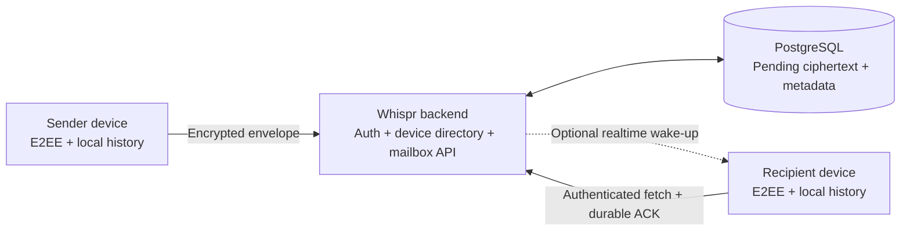

# Whispr

**Private messaging with end-to-end encryption and a local-first future.**

[](./LICENSE)

Whispr is an open-source secure-messaging application built around one principle: **message content should remain under the control of the people communicating, not become a permanent server-side archive.**

The current application provides browser-side encryption and realtime messaging. The next architecture moves long-term chat history to protected device-local storage, uses the backend only to deliver temporary encrypted messages, and introduces verified device identities and recoverable encrypted backups.

> **Project status:** Active development. Whispr is **not yet production-ready**. The documented local-first, self-hosted backend and cloud deployment architecture is a **target design**, not fully implemented software.

## Product direction

- **End-to-end encryption:** Encrypt and decrypt on user devices. Adopt a reviewed authenticated messaging protocol, with per-device sessions and explicit identity verification.
- **Local-first conversations:** Persist history, message state and cryptographic sessions on the device rather than retaining delivered conversations indefinitely on a server.
- **Reliable private delivery:** Temporarily queue recipient-device ciphertext for offline users, retry safely, and delete acknowledged or expired ciphertext under defined retention rules.
- **Multi-device trust and recovery:** Device enrollment, revocation, key-change warnings and user-controlled encrypted backup recovery.
- **Encrypted attachments:** Planned private file/image/video sharing. Encrypt locally and transfer ciphertext through a separately authorized object store.
- **Scalable operations:** Keep a small, modular backend with measurable performance, clear storage ownership and privacy-aware observability.

These describe **the product goals**. See [Implementation status](#implementation-status) for what currently exists.

## Architecture



In the target architecture:

1. The sender encrypts on-device, saves its outgoing state safely, and sends an authenticated ciphertext envelope.
2. The backend commits the pending envelope to PostgreSQL before reporting acceptance.
3. Realtime notifications signal that a mailbox may contain new messages; they are **not** the durable message store.
4. The recipient fetches ciphertext, verifies/decrypts and commits its protected local message and cryptographic state **before acknowledging delivery**.
5. The backend removes acknowledged ciphertext while retaining only short-lived delivery/deduplication metadata. Unacknowledged envelopes expire according to a documented retention policy.

The backend still sees some metadata such as connection and delivery timing. End-to-end encryption does not eliminate endpoint compromise, malicious web scripts or public-key substitution risks. Read the [threat model](./Docs/06_Threat_Model.md).

## Implementation status

| Area | Current repository | Planned direction |
| --- | --- | --- |
| Web application | Next.js/React client at `client/` | Keep and harden the UI; add encrypted local history and reliable offline sync |
| Product messaging | `/app` currently uses Supabase Auth, PostgreSQL, Realtime and browser-side Web Crypto | Replace direct Supabase integrations with authenticated Whispr API controllers |
| Encryption | Browser P-256 ECDH, HKDF-SHA256 and AES-GCM | Reviewed E2EE protocol, per-device sessions, identity verification and safer key storage |
| Backend | Separate Express/Socket.IO service currently powers a legacy test harness | Whispr-owned Node.js/TypeScript modular backend for auth, devices, mailboxes, realtime and media |
| Data | Server retains encrypted messages; browser stores exported key material in `localStorage` | Protected device-local history; temporary pending ciphertext in PostgreSQL |
| Attachments | Full E2EE media pipeline not implemented | Optional private encrypted object storage |
| Hosting | New production deployment not established | Vercel frontend + Render services/PostgreSQL; optional Cloudflare R2 for attachments |

**Security limitations of the current implementation:** the legacy server has an insecure JWT-secret fallback; some privileged demonstration endpoints need isolation/authorization; the existing client keyring export and sign-in-password-derived backup require redesign; and tracked database migrations do not fully match client queries. Do not deploy this prototype with real sensitive conversations without resolving and testing these issues.

A separate legacy `/demo` route exists for testing. It does not represent the future production authentication or storage architecture.

## Technology and hosting

| Layer | Target choice |
| --- | --- |
| Frontend | Next.js + React, hosted on **Vercel** |
| API and realtime | Whispr-owned Node.js/TypeScript controllers + Socket.IO, hosted on **Render** |
| Authentication | Reviewed self-hosted OIDC provider; Keycloak is an evaluated candidate |
| Database | **Render PostgreSQL** for accounts, devices, key metadata and pending encrypted deliveries |
| Device storage | Protected browser IndexedDB/OPFS; evaluated native encrypted database where applicable |
| Cache and presence | **Optional** Render Key Value / Redis-compatible coordination |
| Media storage | **Optional** private Cloudflare R2 for client-encrypted attachments |

**A text-only Whispr deployment does not require AWS S3, Cloudflare R2 or any other blob store.** When media sharing is implemented, an object-storage adapter will enable private, short-lived ciphertext uploads/downloads without making AWS S3 mandatory.

Vercel + Render is the **preferred initial hosting profile**, not an active deployment. The design keeps application controllers, database schema and E2EE rules under Whispr's control while using cloud-managed infrastructure. See the [deployment guide](./Docs/17_Render_Vercel_R2_Deployment.md).

## Run the current code locally

**Requirements:** Node.js and npm versions compatible with the packages in `client/package.json` and `server/package.json`. The existing `/app` flow also requires access to an appropriately configured **legacy Supabase project**; the new backend is not a drop-in replacement yet.

### Client

```bash
git clone https://github.com/utksh1/Whispr.git
cd Whispr/client
npm install
npm run dev
```

Open [http://localhost:3000](http://localhost:3000).

For today's `/app` implementation, create `client/.env.local` with the **existing** Supabase project's public values:

```dotenv
NEXT_PUBLIC_SUPABASE_URL=https://YOUR_EXISTING_PROJECT.supabase.co
NEXT_PUBLIC_SUPABASE_PUBLISHABLE_KEY=your_publishable_key
NEXT_PUBLIC_SUPABASE_PROJECT_REF=your_project_ref
NEXT_PUBLIC_API_URL=http://localhost:4000
```

These variables are **legacy configuration** and do not belong in the future self-hosted client. Never put service-role keys, database passwords or attachment-storage credentials in browser-public environment variables. See the [client guide](./client/README.md).

### Existing Express test service

From the repository root, in another terminal:

```bash
cd server
npm install
cp .env.example .env
# Replace the placeholder JWT_SECRET with a strong unique secret.
# Keep demo/tamper tools disabled outside isolated local testing.
npm start
```

Health endpoint: [http://localhost:4000/health](http://localhost:4000/health).

**Important:** This service currently uses independent test authentication and storage. It is **not** a secure substitute for the production backend being designed; do not publicly expose it with default settings. See the [server guide](./server/README.md).

### Run available tests

```bash
# From client/
npm test
npm run lint
npm run build

# From server/
npm test
```

These commands cover the existing application; they are not evidence that the proposed cryptographic protocol, durable mailbox, OIDC integration or cloud deployment have been implemented and validated.

## Project structure

```text
Whispr/
├── client/       # Current Next.js application
├── server/       # Current Express/Socket.IO service
├── Docs/         # Architecture, security, API, database and deployment decisions
├── CONTRIBUTING.md
└── README.md
```

The future controllers, background workers and deployment configuration will evolve **inside this repository**. The existing Supabase migrations remain legacy evidence until a verified, non-destructive account/key/history migration is complete.

## Documentation

Start with the [documentation index](./Docs/README.md).

| Topic | Document |
| --- | --- |
| System and trust boundaries | [System Architecture](./Docs/04_System_Architecture.md) |
| Encryption and key lifecycle | [Cryptography and Security](./Docs/05_Cryptography_Security_Flow.md) |
| Security risks | [Threat Model](./Docs/06_Threat_Model.md) |
| Data retention and mailbox model | [Database Design](./Docs/08_Database_Design.md) and [Optimized Database](./Docs/14_Optimized_Database_Design.md) |
| API and message delivery | [API Design](./Docs/09_API_Design.md) |
| Caching and scale | [Scalability and Caching](./Docs/13_Scalability_and_Caching.md) |
| Supabase migration | [Self-Hosted Backend and Supabase Exit](./Docs/15_Self_Hosted_Backend_and_Supabase_Exit.md) |
| Cloud deployment | [Vercel + Render + Optional R2](./Docs/17_Render_Vercel_R2_Deployment.md) |
| Implementation sequence | [Development Roadmap](./Docs/10_Development_Roadmap.md) |

## Contributing and security

Contributions are welcome. Read [CONTRIBUTING.md](./CONTRIBUTING.md) before making changes to authentication, cryptography, persistence or network protocols.

Please avoid posting sensitive security findings, credentials, real user messages or private keys in public issues. Report security concerns privately through an established maintainer contact channel.

## License

Whispr is distributed under the [MIT License](./LICENSE).
