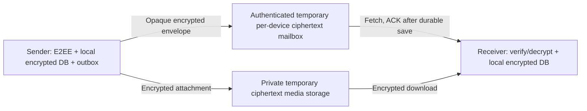

# Whispr

**End-to-end encrypted messaging, redesigned incrementally around local-first privacy.**

[](https://opensource.org/licenses/MIT)

Whispr is the **same existing application and repository**. We're improving its architecture in place rather than launching a separate "2.0" product.

## What works today

| Surface | Implementation today | Limitation |
| --- | --- | --- |
| `/app` | Next.js/React, Supabase Auth, browser ECDH P-256 + HKDF + AES-GCM, Supabase Postgres encrypted message history, Realtime | Server keeps delivered ciphertext; browser exports private keys into `localStorage`; key verification and local encrypted history are not complete |
| `/demo` | Separate Next.js two-client demo using Express/Socket.IO and JWT authentication, repository-backed encrypted messages | Separate identity/storage system; demo tamper/admin tools must not be exposed as production behavior |
| Backend | Express/Socket.IO for demo, plus direct browser-to-Supabase product access | Not yet one unified durable per-device encrypted-delivery protocol |

**Security notice:** The current prototype is **not production-ready**. A compromised server/key directory, web origin, or endpoint may defeat some desired guarantees. The current demo JWT config includes a predictable secret fallback; some admin features lack authentication; database migrations do not fully match client queries. See [Threat Model](./Docs/06_Threat_Model.md).

## Architecture direction (target, NOT implemented)



**Permanent chat history belongs on endpoints.** The backend still temporarily queues ciphertext so offline devices can receive messages, and temporarily stores encrypted media objects. Acknowledged/expired queued ciphertext is deleted under explicit retention rules. Realtime events are wake-up hints rather than the durable source of truth.

The target also includes reviewed ratcheting one-to-one encryption, key verification, per-device identity, local-only search, encrypted media sharing, separate recovery secrets and safe migration of legacy chat history.

This is a **self-hosted modular monolith first** approach: retain Next.js and hardened Node/Express/Socket.IO components, but replace Supabase Auth, direct database APIs, Realtime and Storage with Whispr-owned controllers, self-hosted OIDC and private cloud-managed PostgreSQL/object storage or self-operated equivalents. No Kubernetes, Kafka or broad rewrite is necessary to start.

## Scale and caching direction (target, NOT implemented)

Whispr keeps a **three-tier responsibility split**: encrypted client-local history; a durable PostgreSQL mailbox for **pending** ciphertext; and private object storage for encrypted attachments. Optional **Redis** accelerates allowlisted public metadata, ephemeral device presence, gateway routing and isolated abuse counters. Redis or WebSocket Pub/Sub is **never** the only copy of a pending message.

Deploy the backend as a **modular monolith first**, with stateless APIs and realtime gateways ready for horizontal scaling. Use a transactional notification outbox, device-scoped idempotent messages, reconnect mailbox catch-up, and backpressure when DB/queue capacity is exhausted. CDN use is limited to immutable static assets and authorized encrypted media; plaintext, secrets and private profile fields never enter shared caches.

**Large-scale work is phased:** indexes/expiry + performance metrics first; Redis when multi-gateway coordination is needed; PostgreSQL partitions, Kafka and multi-region home-region routing only after representative load tests prove value.

See [Scalability, Caching and Data Lifecycle](./Docs/13_Scalability_and_Caching.md) for the detailed design and proposed SLOs (none measured or deployed yet).

## Optimized database proposal (target, not implemented)

The target server database is a **temporary per-device mailbox**, not a permanent chat-history store. A narrow `delivery_keys` ledger tracks idempotent send/ACK outcomes; `pending_envelopes` keeps ciphertext only until ACK or expiry; `mailbox_events` stores transactional wake-up intent. PostgreSQL stores minimal identity/media metadata, not attachment bytes. Client devices retain indexed encrypted history and crash-consistent protocol state.

The design explicitly avoids a permanent high-water timestamp cursor (concurrent commits can arrive out of timestamp order), duplicate-redelivery bugs, excessive SQL writes per connection, and premature sharding/partitioning.

See [Optimized Database Design](./Docs/14_Optimized_Database_Design.md). This is **documentation**, not a schema migration or running feature.

## Self-hosted backend decision (TARGET / NOT IMPLEMENTED)

**Supabase is a legacy dependency, not part of Whispr's future runtime.** The target client uses a reviewed self-hosted OIDC provider (Keycloak is a candidate) and Whispr-owned Auth/Device/Key/Mailbox/Realtime/Media/Recovery controllers. The backend runs a private **cloud-managed PostgreSQL** and private cloud object storage (or self-operated equivalents), with optional Redis for ephemeral routing, presence and safe metadata. Device-local encrypted conversation history remains the source of truth.

**Auth separation:** the identity provider holds passwords, MFA and OAuth credentials; Whispr maps verified OIDC issuer/subject to stable account IDs and separately verifies messaging devices. Never promote the current insecure demo JWT implementation to production.

**Migration:** users must verify account linking, recover and re-encrypt old password-derived keyring backups, import legacy ciphertext locally and pass rollback/retention checks before Supabase is retired.

[Self-Hosted Backend and Supabase Exit](./Docs/15_Self_Hosted_Backend_and_Supabase_Exit.md) documents the controller architecture and non-destructive transition.

## Cloud deployment direction (TARGET / NOT DEPLOYED)

**Cloud hosting is compatible with Whispr-owned controllers.** We can deploy the Next.js frontend, Whispr Node/Socket.IO services and a reviewed OIDC identity provider as cloud containers, while using **managed PostgreSQL**, private cloud object storage and optional managed Redis. This retains Whispr's account/device authorization and E2EE keys on the clients and removes Supabase as a future runtime dependency.

AWS ECS/Fargate + RDS PostgreSQL + S3 + secrets/monitoring is a reference implementation, not a locked-in vendor. A protected single-region deployment is preferable to building Kubernetes, Kafka or multi-region from day one. Verify IAM, TLS, database backups, object-store access controls, WebSocket reconnect and cloud cost budgets.

[Cloud Hosting and Deployment](./Docs/16_Cloud_Hosting_and_Deployment.md) documents the infrastructure profiles and security gates.

## Preferred initial deployment: Vercel + Render (TARGET / NOT DEPLOYED)

**Vercel** is the preferred Next.js frontend host (`client/`); **Render** is the preferred backend host for Whispr's authenticated API, Socket.IO and the selected reviewed OIDC provider, with **paid Render PostgreSQL** for pending ciphertext and metadata. **Render Key Value/Redis remains optional**.

**No AWS S3 or Cloudflare R2 is necessary for text-only encrypted messaging.** When secure file/image/video sharing is built, use **private Cloudflare R2** as the preferred encrypted-media store with scoped short-lived signed URLs and browser-side encryption. AWS S3 and other approved blob providers remain interchangeable through a storage adapter; don't store user uploads in Render service files or expose a public R2 bucket.

The choice does **not** change client-local chat history or the gradual removal of legacy Supabase. No Vercel, Render or R2 service has been deployed by this documentation change.

[Vercel + Render + Optional R2 deployment guide](./Docs/17_Render_Vercel_R2_Deployment.md).

## Setup for current code

### Web client

```bash
cd client
npm install
npm run dev
```

**For current legacy code only**, create `client/.env.local` with the existing Supabase public URL/publishable key and any needed demo API URL. New self-hosted environment variables are not yet consumed by the client. See [client README](./client/README.md) and [legacy Supabase setup and exit](./Docs/10_Supabase_Setup.md). **No `client/.env.example` is currently tracked.**

### Demo API

```bash
cd server
npm install
npm start
```

`server/.env.example` is provided; copy it to `server/.env` and use a **unique strong `JWT_SECRET`** before exposing any authenticated endpoint. Disable demo tools outside isolated development. Server health: `http://localhost:4000/health`. Read [server README](./server/README.md).

## Documentation — updated in place

Start at [Documentation Index](./Docs/README.md). Key files:

- [System Architecture](./Docs/04_System_Architecture.md) — current and target trust boundaries
- [Cryptography](./Docs/05_Cryptography_Security_Flow.md) — current P-256/AES-GCM and future reviewed protocol
- [Threat Model](./Docs/06_Threat_Model.md) — what E2EE does and **does not** guarantee
- [Database Design](./Docs/08_Database_Design.md) — local history, server mailbox, migration safety
- [API Design](./Docs/09_API_Design.md) — current endpoints vs proposed mailbox/media API
- [Roadmap](./Docs/10_Development_Roadmap.md) — ordered implementation PRs and release gates

Contributing: [CONTRIBUTING.md](./CONTRIBUTING.md). **Target documentation is not evidence of completed code.**

## Privacy promise (bounded)

A database dump should not reveal chat plaintext when endpoints and keys are secure. Nevertheless, the service sees routing and timing metadata; a malicious directory can substitute keys without verification; a hostile browser-delivered script can read endpoint data. We will document these limits rather than claiming unconditional protection from every backend compromise.

## License

MIT — see [LICENSE](./LICENSE).
