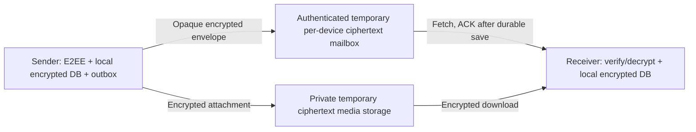

# Whispr

**End-to-end encrypted messaging, redesigned incrementally around local-first privacy.**

[](https://opensource.org/licenses/MIT)

Whispr is the **same existing application and repository**. We're improving its architecture in place rather than launching a separate "2.0" product.

## What works today

| Surface | Implementation today | Limitation |
| --- | --- | --- |
| `/app` | Next.js/React, Supabase Auth, browser ECDH P-256 + HKDF + AES-GCM, Supabase Postgres encrypted message history, Realtime | Server keeps delivered ciphertext; browser exports private keys into `localStorage`; key verification and local encrypted history are not complete |
| `/demo` | Separate Next.js two-client demo using Express/Socket.IO and JWT authentication, repository-backed encrypted messages | Separate identity/storage system; demo tamper/admin tools must not be exposed as production behavior |
| Backend | Express/Socket.IO for demo, plus direct browser-to-Supabase product access | Not yet one unified durable per-device encrypted-delivery protocol |

**Security notice:** The current prototype is **not production-ready**. A compromised server/key directory, web origin, or endpoint may defeat some desired guarantees. The current demo JWT config includes a predictable secret fallback; some admin features lack authentication; database migrations do not fully match client queries. See [Threat Model](./Docs/06_Threat_Model.md).

## Architecture direction (target, NOT implemented)



**Permanent chat history belongs on endpoints.** The backend still temporarily queues ciphertext so offline devices can receive messages, and temporarily stores encrypted media objects. Acknowledged/expired queued ciphertext is deleted under explicit retention rules. Realtime events are wake-up hints rather than the durable source of truth.

The target also includes reviewed ratcheting one-to-one encryption, key verification, per-device identity, local-only search, encrypted media sharing, separate recovery secrets and safe migration of legacy chat history.

This is a **modular monolith first** approach: retain the Next.js UI, Supabase Auth and PostgreSQL while replacing storage and delivery contracts. No Kubernetes, Kafka or broad rewrite is necessary to start.

## Setup for current code

### Web client

```bash
cd client
npm install
npm run dev
```

Create `client/.env.local` with the Supabase public URL/publishable key and any needed API URL. See [client README](./client/README.md) and [Supabase setup](./Docs/10_Supabase_Setup.md). **No `client/.env.example` is currently tracked.**

### Demo API

```bash
cd server
npm install
npm start
```

`server/.env.example` is provided; copy it to `server/.env` and use a **unique strong `JWT_SECRET`** before exposing any authenticated endpoint. Disable demo tools outside isolated development. Server health: `http://localhost:4000/health`. Read [server README](./server/README.md).

## Documentation — updated in place

Start at [Documentation Index](./Docs/README.md). Key files:

- [System Architecture](./Docs/04_System_Architecture.md) — current and target trust boundaries
- [Cryptography](./Docs/05_Cryptography_Security_Flow.md) — current P-256/AES-GCM and future reviewed protocol
- [Threat Model](./Docs/06_Threat_Model.md) — what E2EE does and **does not** guarantee
- [Database Design](./Docs/08_Database_Design.md) — local history, server mailbox, migration safety
- [API Design](./Docs/09_API_Design.md) — current endpoints vs proposed mailbox/media API
- [Roadmap](./Docs/10_Development_Roadmap.md) — ordered implementation PRs and release gates

Contributing: [CONTRIBUTING.md](./CONTRIBUTING.md). **Target documentation is not evidence of completed code.**

## Privacy promise (bounded)

A database dump should not reveal chat plaintext when endpoints and keys are secure. Nevertheless, the service sees routing and timing metadata; a malicious directory can substitute keys without verification; a hostile browser-delivered script can read endpoint data. We will document these limits rather than claiming unconditional protection from every backend compromise.

## License

MIT — see [LICENSE](./LICENSE).
