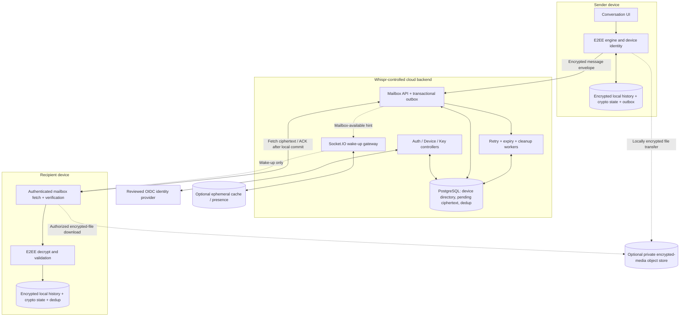

# Whispr

**End-to-end encrypted messaging designed for privacy, device ownership, and reliable delivery.**

[](./LICENSE)

Whispr is an open-source messaging application being developed around a **local-first security model**: people control their conversation history on their own devices, while a backend temporarily delivers encrypted messages and manages the minimum operational data needed to keep messaging reliable.

The repository currently contains a working **Next.js browser application**, client-side cryptography, and a separate **Express/Socket.IO service**. Its next architecture replaces the current Supabase-dependent product integration with **Whispr-owned backend controllers**, a reviewed authentication provider, a temporary device-addressed ciphertext mailbox, and protected local storage.

> **Development status:** Whispr is under active development and is **not production-ready**. This README carefully separates **implemented behavior** from **planned design**. The planned cryptography, local-first persistence, self-hosted controllers, and cloud infrastructure must not be treated as shipped or independently audited.

## Contents

- [What Whispr is building](#what-whispr-is-building)
- [Implementation status](#implementation-status)
- [How the architecture works](#how-the-architecture-works)
- [Message delivery lifecycle](#message-delivery-lifecycle)
- [Data ownership and database design](#data-ownership-and-database-design)
- [Security and cryptography](#security-and-cryptography)
- [Identity, devices, and recovery](#identity-devices-and-recovery)
- [Encrypted attachments](#encrypted-attachments)
- [Cloud deployment](#cloud-deployment)
- [Repository structure](#repository-structure)
- [Getting started locally](#getting-started-locally)
- [Testing and quality gates](#testing-and-quality-gates)
- [Implementation roadmap](#implementation-roadmap)
- [Documentation](#documentation)
- [Contributing and security reports](#contributing-and-security-reports)
- [License](#license)

## What Whispr is building

### Core principles

1. **Encryption happens on endpoints.** Messages are encrypted before leaving the sending device and decrypted on authorized receiving devices. Application servers do not need plaintext to relay content.
2. **Chat history belongs to devices.** The intended long-term conversation store is a protected local database. The backend is **not** the permanent archive of delivered message content.
3. **Offline delivery must still work.** Encrypted envelopes can wait in an authenticated, recipient-specific server mailbox while a device is offline. They are removed after a durable device acknowledgement or an expiry policy.
4. **Identity deserves independent verification.** Account sign-in is not proof that a public messaging key belongs to the expected person. The design includes device keys, verified bindings, key-change warnings, and revocation.
5. **Recovery is explicit.** A new login, lost device, storage eviction, or deleted installation must not silently imply that the backend can regenerate private keys or recover locally deleted conversations.
6. **Infrastructure is replaceable.** Whispr owns its application rules and database schema; cloud platforms host the components. Redis, large-scale message brokers, and remote object storage are added only when their features require them.

### Planned product capabilities

| Capability | Intended behavior | Status |
| --- | --- | --- |
| Private one-to-one messaging | Client-side encryption with authenticated peer identity | **Partial today**; stronger protocol and verification planned |
| Realtime conversations | Sender/receiver updates while connected | **Present in legacy implementations**, not yet one unified delivery system |
| Offline messaging | Durable per-recipient-device ciphertext mailbox and retry | **Planned** |
| Persistent local history | Protected IndexedDB-backed messages and session state | **Planned** |
| Secure multi-device support | Independent device identities, enrollment, revocation, fanout | **Planned** |
| Key verification | Identity pinning, safety-number-style comparison, change warnings | **Planned** |
| Account and device recovery | User-controlled encrypted backups with a separate recovery secret | **Planned** |
| Encrypted file/image/video sharing | Client encryption and authorized private blob transfer | **Planned, optional** |
| Presence and notifications | Ephemeral connection routing and reconnect catch-up | **Partly present**; redesigned reliability planned |
| Group E2EE | A reviewed group protocol and membership semantics | **Deferred** |

**Why the distinction matters:** an encrypted payload and a realtime UI are not enough to claim audited end-to-end security, key authenticity, forward secrecy, multi-device correctness, or recovery from all data loss.

## Implementation status

The current repository has **two different messaging paths**. They should not be mistaken for one complete production system.

| Area | Current implementation | Limitations / next work |
| --- | --- | --- |
| Product web route (`/app`) | Next.js/React, Supabase Auth, Supabase PostgreSQL and Realtime, browser Web Crypto | Existing server-side ciphertext history; direct Supabase browser integration must be migrated |
| Isolated test route (`/demo`) | Next.js UI backed by separate Express/Socket.IO API, JWTs and repository adapters | Independent auth/storage semantics; demonstration and privileged operations are not production-ready |
| Cryptographic primitives | Browser P-256 ECDH, HKDF-SHA256 and AES-GCM | Not a reviewed asynchronous ratcheting protocol; peer identity verification and multi-device trust need redesign |
| Private-key handling | Browser keyring material exported into ordinary `localStorage` | Move to a threat-reviewed protected local key/state design |
| Encrypted backups | Current keyring backup depends on a key derived from the login password | Add an independent recovery secret and tested re-encryption/restore flow |
| Backend storage | Retained ciphertext messages and incompatible migration assumptions across code paths | Implement pending-only mailboxes, scoped device authorization and a consistent schema |
| Authentication | Supabase for product; separate legacy JWT for test service | Replace with reviewed OIDC sign-in + Whispr-controlled controller authorization |
| Deployment | Preferred hosting architecture is documented | Vercel/Render/R2 target services are **not established production infrastructure** |

### Known security blockers

The current code should not handle real sensitive conversations without additional review. Known issues include:

- The legacy Express server supplies a **predictable default JWT secret** when configuration is missing.
- Some privileged test/admin functionality lacks the authorization guarantees needed for public access.
- Persisting exported private-key material in ordinary browser storage increases exposure to XSS and malicious same-origin JavaScript.
- The legacy encrypted-backup process is entangled with sign-in credentials; changing authentication can make old backups inaccessible.
- Current clients do not provide robust cryptographic peer identity verification or a reviewed multi-device ratchet.
- The committed Supabase migrations and application data expectations require schema reconciliation.

These are **open engineering risks**, not vulnerabilities that a README change has fixed. See [Cryptography and Security](./Docs/05_Cryptography_Security_Flow.md), [Threat Model](./Docs/06_Threat_Model.md), and [Development Roadmap](./Docs/10_Development_Roadmap.md).

## How the architecture works

### Target logical architecture — not yet implemented



**The diagram shows logical responsibilities, not a requirement to deploy every controller as its own microservice.** Start with a modular backend process. Separate gateways, workers, and cache infrastructure only when justified by performance or availability requirements.

### Controller responsibilities

| Target module | Responsibility |
| --- | --- |
| **Auth Controller** | Validate trusted OIDC tokens and map identity-provider accounts to stable Whispr account IDs |
| **Device Controller** | Device enrollment, authenticated device binding, listing and revocation |
| **Key Controller** | Signed public device-key bundles, prekey lifecycle and version/change metadata |
| **Mailbox Controller** | Recipient-scoped encrypted envelope acceptance, fetch, idempotent ACK and expiry rules |
| **Realtime Controller** | Authenticated Socket.IO connections, ephemeral presence and new-mailbox wake-up hints |
| **Media Controller** | Authorize encrypted uploads/downloads, size limits, object lifecycle and scoped capabilities |
| **Recovery Controller** | Store and fetch opaque, versioned encrypted backups without learning recovery secrets |
| **Background workers** | Transactional notification publication, envelope expiration, media cleanup and bounded retries |

Controllers should delegate authorization and business rules to testable services/policies, with repository adapters for PostgreSQL and optional integrations.

For diagrams and full trust boundaries, read [System Architecture](./Docs/04_System_Architecture.md) and [API Design](./Docs/09_API_Design.md).

## Message delivery lifecycle

The intended message path is **at-least-once transport with idempotent application effects**, not a claim that WebSocket delivery alone is reliable.

### 1. Sending

The sender verifies the recipient-device key state and uses a reviewed E2EE session to produce an opaque, versioned ciphertext envelope. The client persists its outgoing envelope and updated session/outbox state durably before transmission.

Each recipient device has an authorized destination and a stable envelope/idempotency identifier. The server must derive the sender account/device from authenticated context rather than trusting a submitted sender ID.

### 2. Server acceptance

The Mailbox Controller validates destination authorization, size/expiry limits and deduplication. A PostgreSQL transaction stores:

- A small recipient-device-specific delivery/idempotency record.
- The **pending ciphertext envelope**, which exists only until ACK or expiry.
- A transactional notification-outbox event that can be retried if the realtime service is unavailable.

Only a committed transaction can be reported as **accepted**. A successful Redis publish or Socket.IO emit is *not* proof of durable persistence.

### 3. Realtime delivery and offline catch-up

An online recipient may receive a `mailbox:available` hint over Socket.IO and fetch pending envelopes from the server.

Offline or disconnected clients **must fetch the mailbox after reconnection even if no notification arrived**. The backend remains responsible for pending ciphertext until the authorized device confirms durable persistence or the retention deadline expires.

### 4. Recipient acknowledgement

The recipient validates/decrypts the envelope and commits its message, session/ratchet state and dedup marker in protected local storage. **Only after that commit** does it send a device-authenticated ACK.

The server marks the compact delivery ledger terminal and removes the corresponding ciphertext payload. The deduplication/terminal record remains only for a bounded retry window; it must not become a permanent content archive.

### 5. Failure and expiry

If a device crashes **before** local commit, no ACK should be sent, and the pending envelope can be redelivered. If it crashes **after** commit but before ACK, a repeated delivery must be deduplicated safely.

A timestamp-based keyset cursor is appropriate for **paging one mailbox sweep**, not as a guaranteed permanent commit-order checkpoint. Reconnect and periodic fresh sweeps protect against rows that commit late.

Expired but undelivered messages must be represented as expired rather than falsely reported as delivered. Exact envelope TTLs, retry limits and service-level objectives are **design parameters to validate**, not current implementation guarantees.

### Delivery states

| State | Meaning |
| --- | --- |
| `local_queued` | Sender saved encrypted envelope locally but has not received server acceptance |
| `accepted` | Server durably committed pending ciphertext |
| `delivering` | An attempt or notification is in progress; **not** proof of recipient persistence |
| `delivered` | Intended recipient device durably saved and acknowledged its envelope |
| `read` | A separate, optional encrypted user-level event; not equivalent to delivered |
| `expired` | Pending ciphertext reached server retention deadline |
| `failed` | An explicit permanent failure; retryable transport errors are not permanent failure |

See [API and Delivery Protocol](./Docs/09_API_Design.md) and [Scalability and Caching](./Docs/13_Scalability_and_Caching.md) for precise contracts and failure testing.

## Data ownership and database design

Whispr's target splits storage by **who needs to retain the data**, not simply by technology.

| Storage | Data it owns | Data it must not retain |
| --- | --- | --- |
| **Client RAM** | Currently displayed decrypted messages and transient UI state | Persistent secrets without protection |
| **Protected local IndexedDB / OPFS** | Long-term encrypted history, sessions, identity pins, outbox, dedup and attachments | A supposedly recoverable history without backup/recovery policy |
| **Render PostgreSQL** | Whispr account/identity mapping, device directory, public prekeys, pending ciphertext, bounded delivery receipts/outbox | Permanently delivered chat history, plaintext or password credentials |
| **Optional Render Key Value** | Ephemeral presence, gateway routing, allowlisted public metadata and protected rate-limit counters | Undelivered-message source of truth, plaintext or private keys |
| **Optional Cloudflare R2** | Encrypted attachment bytes and temporary objects, once media is enabled | Attachment decryption keys, plaintext filenames or previews |
| **OIDC provider store** | Sign-in accounts, credentials and MFA as required by the chosen provider | E2EE device private keys or conversation plaintext |

### Target PostgreSQL tables

The detailed [optimized database design](./Docs/14_Optimized_Database_Design.md) proposes a small schema optimized for device-specific inbox reads and deletion-heavy workloads:

- `accounts` and `account_identities`: stable Whispr account IDs linked to verified OIDC `(issuer, subject)` pairs.
- `public_profiles`, `devices` and public prekey tables: minimum permitted identity/directory information.
- `delivery_keys`: compact per-device idempotency and terminal ACK/expiry records.
- `pending_envelopes`: ciphertext only while pending, indexed for recipient-device keyset fetch and expiry.
- `mailbox_events`: transactional notification outbox, not a permanent message log.
- `media_objects` and `encrypted_backups`: optional opaque metadata, with explicit access and retention rules.

Avoid an unnecessary server-side conversations/messages archive, oversized JSON metadata, excessive indexes and database writes for every typing event or presence heartbeat. The target schema is **documented, not migrated**.

### Local storage and recovery considerations

IndexedDB is not automatically encrypted at rest. The intended implementation requires explicit local protection, carefully managed keys, atomic changes to message/ratchet state, quota/eviction handling, and honest recovery behavior.

A browser can lose storage, users can reinstall the app, and multiple tabs may race over the same cryptographic session. The design must ensure a single safe writer or equivalent transactional coordination before advertising durable encrypted history.

## Security and cryptography

### Current cryptography vs target

The existing client uses **P-256 ECDH, HKDF-SHA256 and AES-GCM** to protect message content in the browser. Those are cryptographic primitives, **not a complete reviewed secure-messaging protocol**.

The target includes a reviewed asynchronous session protocol with appropriately authenticated device identities, forward-secrecy/post-compromise properties **only to the extent proven by the selected implementation**, replay protection, multi-device sessions, protocol versioning and safe key-state persistence.

Do not implement a new custom ratchet without independent protocol review. Whispr should reuse a well-analyzed protocol/library and run published test vectors plus adversarial crash/replay tests.

### Trust boundaries

**A message being encrypted does not mean every privacy risk disappears.**

- **Server or DB compromise:** ciphertext confidentiality depends on uncompromised client keys and correct E2EE. The server may still expose recipient IDs, timing, IP/connection and delivery metadata.
- **Malicious key directory:** a server might substitute public device keys unless clients pin/verify identity and warn about changes.
- **Browser compromise:** XSS, malicious extensions or altered frontend JavaScript can read decrypted content or invoke cryptographic operations.
- **Account compromise:** stolen login sessions can threaten device enrollment. OIDC authentication is separate from verified messaging-device identity.
- **Device loss:** local-first history can become permanently unavailable without explicitly configured recovery or paired-device transfer.
- **Traffic analysis:** TLS and encryption do not hide all who-talked-to-whom metadata from network operators or relays.

The project's objective is to **minimize risk and retained sensitive data**, not to claim protection against every adversary.

### Security rules for contributors

- Never log plaintext conversations, raw private keys, recovery secrets, bearer tokens or presigned media URLs.
- Never accept client-supplied account/device ownership fields without independent authorization.
- Never report a message as delivered before the recipient's durable local ACK.
- Never treat Redis/WebSocket publication as durable queue storage.
- Never cache decrypted content or private authenticated API responses at shared CDNs.
- Never expose internal database, IdP database or R2 access credentials to frontend-public environment variables.
- Require negative tests for cross-account reads, revoked devices, token validation, stale key bundles and backup restore failures.

The [Threat Model](./Docs/06_Threat_Model.md) contains the broader security checklist.

## Identity, devices, and recovery

### Authentication is not messaging identity

The preferred future login architecture uses a **reviewed, cloud-hosted OIDC provider**; Keycloak remains a candidate, not an installed requirement. Whispr's API validates issuer, audience, signature, expiry and trusted key information, then maps the verified identity to a stable internal account.

New devices still require a separate enrollment policy, cryptographic key binding, explicit verification/revocation and peer-visible identity-change handling. Do **not** merge old and new accounts simply because their displayed email addresses match.

### Device model

The planned system treats every enrolled device independently:

- A device has its own messaging identity and key/session state.
- Senders can address each authorized recipient device with an encrypted envelope.
- Each device acknowledges its own pending envelope; ACK by one device must not drop mail for another.
- Revoked devices must lose future mailbox/prekey privileges according to a tested policy.
- Multiple open browser tabs must not independently corrupt one device's session state.

### Backup and account migration

The **current** encrypted key backup uses a key derived from the login password. Changing to a different OIDC login can therefore make a user's old keys or history inaccessible if migration is careless.

The planned migration recovers existing key material with the old credential **before** changing auth providers, re-encrypts it with a separate user-controlled recovery secret, tests restore, and only then retires the legacy system. Existing ciphertext history is imported and verified locally before any server archive is removed.

Recovery of a conversation **backup** does not automatically mean restoring an active ratchet session safely onto several devices. This distinction must be specified and tested.

See [Self-Hosted Backend and Supabase Exit](./Docs/15_Self_Hosted_Backend_and_Supabase_Exit.md).

## Encrypted attachments

**Remote object storage is optional for text-only messaging.** Whispr does not require AWS S3 or Cloudflare R2 to send small encrypted text envelopes.

When attachments are implemented, the preferred store is a **private Cloudflare R2 bucket**, accessed through a storage abstraction so that a reviewed alternative can be adopted later.

### Planned attachment workflow

1. The sender encrypts the file locally in authenticated chunks and creates an integrity-checked manifest.
2. The Whispr Media Controller authenticates the device, validates size/quota/expiry and issues a short-lived, object-scoped upload capability.
3. The client sends **ciphertext directly** to the private object store. The backend does not need the file key.
4. The sender delivers the file reference, manifest and decryption information through an E2EE message to authorized recipient devices.
5. The receiver obtains a newly authorized download capability, downloads ciphertext and verifies/decrypts locally.
6. Cleanup workers remove expired or abandoned objects while respecting multi-device/multi-recipient access and retention rules.

**Important:** R2 presigned URLs are bearer capabilities while valid. A private bucket, exact CORS origins, limited methods/TTLs, authorization checks and safe log handling are still required. A signed R2 S3 API URL should not be assumed to work unchanged under an arbitrary custom media hostname.

See [Vercel + Render + Optional R2](./Docs/17_Render_Vercel_R2_Deployment.md).

## Cloud deployment

### Preferred initial production layout — NOT DEPLOYED

| Component | Planned provider | Notes |
| --- | --- | --- |
| **Web frontend** | **Vercel** | Deploy `client/` from the existing monorepo; keep decryption and private history client-side |
| **Backend API + Socket.IO** | **Render Web Service** | Run Whispr-controlled controllers on an always-on service, initially together |
| **Authentication** | **Render-hosted reviewed OIDC provider** | Keycloak is an option; use separate protected credential storage |
| **Database** | **Paid Render PostgreSQL** | Operational metadata and temporary encrypted envelopes, with tested backups |
| **Delivery/retention workers** | **Render** | Reliable transactional-outbox publication, queue expiry and cleanup |
| **Cache/presence** | **Optional Render Key Value** | Add when gateway replicas, rate limiting or measured caching need it |
| **Encrypted media** | **Optional Cloudflare R2** | Enable only alongside the encrypted attachment feature |

The hosted system is **Whispr-controlled**, not dependent on Supabase APIs. Using a managed database does not mean building a new database engine or manually maintaining physical hosts.

### Practical deployment constraints

- The **current code cannot be deployed as the finished target merely by adding environment variables**. Auth controllers, mailbox schema, local storage and migration must first be implemented.
- Render's sleeping/free web-service behavior is inappropriate for reliable live message delivery. A real-user service needs always-on hosting, reconnect-safe WebSockets and monitored background work.
- Durable user devices and pending mailboxes require a **paid, backed-up PostgreSQL service**, not an expiring disposable database.
- Use HTTPS/WSS, private DB connections, exact allowed frontend origins, strict OIDC redirect URIs, server-only secrets and least-privilege storage credentials.
- Keep Docker-based development environments reproducible; add Render/Vercel deployment and infrastructure-as-code files only after their runtime behavior is tested.
- Start in a single region, measure load, then decide whether additional gateways, managed cache, data partitioning or multi-region routing are necessary.

For provider configuration, failure modes, and optional R2 usage, read [Deployment Guide](./Docs/17_Render_Vercel_R2_Deployment.md). The [cloud-neutral architecture](./Docs/16_Cloud_Hosting_and_Deployment.md) documents alternative providers.

## Repository structure

```text
Whispr/
├── client/                        # Existing Next.js app and browser cryptography
│   ├── src/
│   └── package.json
├── server/                        # Existing Express/Socket.IO service
│   ├── src/
│   ├── supabase/migrations/       # Legacy tracked SQL; migration evidence
│   ├── .env.example
│   └── package.json
├── Docs/                          # Architecture, threat model, API, DB, roadmap, hosting
├── CONTRIBUTING.md
├── LICENSE
└── README.md
```

This is the **existing repository**. The planned `server/src/modules/` controller layout, self-managed migration directory, worker separation and deployment manifests are **future changes**, not files already present.

## Getting started locally

### Prerequisites

- Git, Node.js and npm compatible with the committed client/server dependencies.
- A browser for the Next.js application.
- For the existing `/app` functionality, access to the **current legacy Supabase project** with the expected schema and Auth configuration.
- Two terminals if running both the web app and the separate Express service.

The local commands below run today's code. They do **not** provision OIDC, a pending-only mailbox, a Render database or R2.

### 1. Clone the repository

```bash
git clone https://github.com/utksh1/Whispr.git
cd Whispr
```

### 2. Configure and start the Next.js client

```bash
cd client
npm install
```

Create `client/.env.local` manually for the **current Supabase-dependent app**:

```dotenv
NEXT_PUBLIC_SUPABASE_URL=https://YOUR_EXISTING_PROJECT.supabase.co
NEXT_PUBLIC_SUPABASE_PUBLISHABLE_KEY=your_publishable_key
NEXT_PUBLIC_SUPABASE_PROJECT_REF=your_project_ref
NEXT_PUBLIC_API_URL=http://localhost:4000
```

These are **current/legacy** variables, not the new platform's configuration. `NEXT_PUBLIC_*` values are exposed to browser JavaScript. Never put Supabase service-role credentials, PostgreSQL passwords, IdP client secrets, R2 secret keys or recovery material there.

```bash
npm run dev
```

Open [http://localhost:3000](http://localhost:3000). The current `/app` may still require existing, correctly migrated Supabase data and Auth settings.

### 3. Start the legacy Express service separately

Open a second terminal in the repository root:

```bash
cd server
npm install
cp .env.example .env
```

**Before starting:** edit `server/.env`, replace the placeholder `JWT_SECRET` with a unique high-entropy secret, and disable `ENABLE_DEMO_TOOLS` outside a tightly isolated test session. The current code has a fallback-secret problem; do not expose this server publicly even if the example file has been edited.

```bash
npm start
```

Check the health endpoint:

```bash
curl http://localhost:4000/health
```

The Express service uses separate legacy JWT and storage mechanisms; starting it **does not** complete the production integration with `/app`.

### 4. Development commands

| Directory | Command | Purpose |
| --- | --- | --- |
| `client/` | `npm run dev` | Next.js development server |
| `client/` | `npm run build` | Build web application |
| `client/` | `npm run lint` | Existing ESLint check |
| `client/` | `npm test` | Existing Vitest suite |
| `server/` | `npm run dev` | Node watch-mode development |
| `server/` | `npm start` | Start existing Express service |
| `server/` | `npm test` | Existing Node test runner |

See [Client Setup](./client/README.md) and [Server Setup](./server/README.md) for the currently supported service options. There is no verified one-command production deployment in this repository.

## Testing and quality gates

### Existing checks

```bash
# Run from repository root
cd client
npm test
npm run lint
npm run build

cd ../server
npm test
```

Passing these commands covers only tests implemented in today's repository. It does not certify future cryptography or deployment behavior.

### Required tests before production use

| Area | Minimum security/correctness gate |
| --- | --- |
| **OIDC and sessions** | Reject forged, expired, wrong-issuer/audience tokens; test logout, device binding, CSRF/CORS and unverified account linking |
| **Encryption** | Reviewed protocol vectors, peer identity changes, replay/out-of-order input, corruption, session rollover and state restoration |
| **Client-local database** | Atomic message/outbox/ratchet state, browser multi-tab contention, storage eviction, crash recovery and safe backup restore |
| **Mailbox** | Scoped enqueue/fetch/ACK, duplicate sends and ACKs, after-commit notification failure, expiry races and sender abuse quotas |
| **Realtime** | Socket disconnect, Render restart, missed Redis notifications and complete pending-mailbox catch-up |
| **Database** | Migrations from an empty test DB, least-privilege role tests, query-plan/index review, bounded cleanup, restore drills |
| **Encrypted media** | Wrong-device/private-bucket access denial, expired signed URLs, malformed ciphertext, safe previews, quota and orphan cleanup |
| **Migration** | Verified Supabase-to-OIDC identities, old keyring recovery/rekey, historical message import, read-only rollback and authorized retirement |
| **Operations** | No plaintext/secret logs, restricted credentials, incident alerts, SLO/load measurements, costs and failure injection |

The [roadmap](./Docs/10_Development_Roadmap.md) and [threat model](./Docs/06_Threat_Model.md) define additional release gates.

## Implementation roadmap

Whispr is evolving **inside the current repository**. The sequence prioritizes a correct secure-messaging foundation over adding unnecessary infrastructure.

| Phase | Objective | Exit condition |
| --- | --- | --- |
| **1 — Secure the prototype** | Fix predictable JWT secret, isolate privileged routes, reconcile old schema, establish CI gates | No insecure defaults; known risks have verified tests |
| **2 — Local-first foundation** | Protected local database, outbox/inbox, crash-safe cryptographic state, storage lifecycle | Data survives expected crashes and retries without state corruption |
| **3 — Identity and protocol** | Select reviewed E2EE library, trusted key bundles, device enrollment/revocation, OIDC account mapping | Peer verification and cross-device auth-negative tests pass |
| **4 — Durable messaging** | Render-backed pending mailbox, idempotency ledger, outbox worker, ACK, expiry, reconnect sync | No logical duplicate/lost pending messages in crash and retry tests |
| **5 — Hosting and migration** | Vercel + Render deployment, backed-up Postgres, verified legacy identity/key/history recovery | Staged cutover/rollback tests and operational restore drills pass |
| **6 — Optional media** | Private R2 adapter, client-encrypted chunks, signed transfer controls and cleanup | Text-only mode remains functional without R2; attachment security tests pass |
| **7 — Measured scaling** | More gateways/workers, optional Key Value, query tuning, SLO/alerting | Representative load tests demonstrate why scaling is needed |

**Not initial prerequisites:** Kafka, Kubernetes, active-active multi-region databases, large-scale partitioning or a custom cryptographic ratchet.

## Documentation

The [Docs index](./Docs/README.md) is the canonical reference for architecture and engineering decisions.

| Topic | Reference |
| --- | --- |
| Product overview and goals | [Project Overview](./Docs/01_Project_Overview.md) · [Core Features](./Docs/03_Core_Features.md) |
| System topology and ownership | [System Architecture](./Docs/04_System_Architecture.md) |
| Cryptographic design and limitations | [Cryptography and Security](./Docs/05_Cryptography_Security_Flow.md) · [Threat Model](./Docs/06_Threat_Model.md) |
| Database and delivery state | [Data Retention Design](./Docs/08_Database_Design.md) · [Optimized Database](./Docs/14_Optimized_Database_Design.md) |
| API and message protocol | [API Design](./Docs/09_API_Design.md) |
| Realtime, caching and performance | [Scalability and Caching](./Docs/13_Scalability_and_Caching.md) |
| Legacy Supabase exit | [Self-Hosted Backend and Supabase Exit](./Docs/15_Self_Hosted_Backend_and_Supabase_Exit.md) · [Legacy Supabase Setup](./Docs/10_Supabase_Setup.md) |
| Preferred cloud hosting | [Vercel + Render + Optional Cloudflare R2](./Docs/17_Render_Vercel_R2_Deployment.md) |
| Other cloud options | [Cloud Hosting and Deployment](./Docs/16_Cloud_Hosting_and_Deployment.md) |
| Engineering milestones | [Development Roadmap](./Docs/10_Development_Roadmap.md) |

## Contributing and security reports

Whispr welcomes contributions to its code, architecture, tests and documentation. Please read [CONTRIBUTING.md](./CONTRIBUTING.md) for local development expectations, PR review standards and security-sensitive changes.

When proposing authentication, E2EE, local persistence, retention, database or media work, state **what is already implemented, what the PR changes, what remains planned, and which negative security tests passed**. Avoid claiming protocol safety, reliable delivery or backend-compromise resistance based only on encrypted message screenshots.

**Security reporting:** Do not disclose private credentials, real user messages, exploitable details or key material in public issues. Use an established private maintainer contact channel for sensitive reports. No public vulnerability-response address is assumed here.

## License

Whispr is licensed under the [MIT License](./LICENSE).
